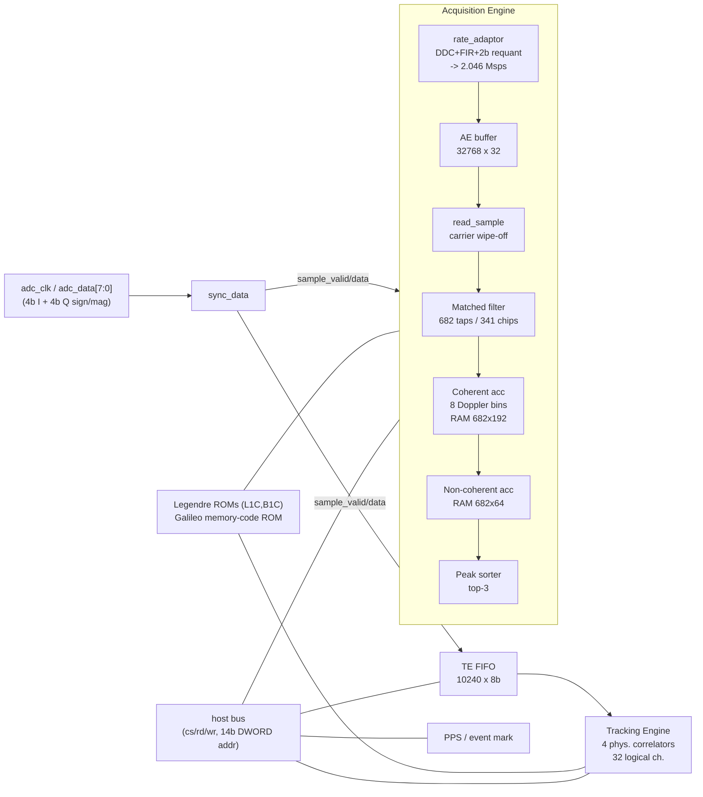
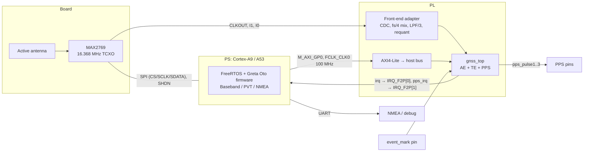

# Greta Oto on AMD Zynq with a MAX2769 Front End — Implementation Study

This study looks at what it takes to run the Greta Oto baseband (RTL in `BB_HW/rtl`) and firmware (`Firmware/`) on real hardware: an AMD Zynq SoC with a Maxim/ADI MAX2769 GNSS front end configured as follows:

| Item | Value |
|---|---|
| RF band | GPS L1 / Galileo E1 / BDS B1C (1575.42 MHz) |
| Front-end output | **I-only, real IF** (no Q channel) |
| IF center frequency | **4.092 MHz** (= fs/4) |
| Sampling frequency | **16.368 MHz** |

The study pays most attention to the **acquisition engine (AE)**: its RAM and logic requirements and how it is affected by the new front end.

> **Note on the numbers.** No FPGA tool was run for this study. The memory figures come straight from the RTL and are exact. The LUT/FF figures are hand estimates made from the RTL structure and could be off by about ±30%. Section 9, Step 2, explains how to replace them with out-of-context synthesis results before choosing a device.

---

## 1. Summary of conclusions

1. **The baseband can't take the MAX2769 samples directly.** `gnss_top` expects **complex** 8-bit samples: 4-bit sign/magnitude I in bits [7:4] and 4-bit Q in bits [3:0]. The magnitude is always odd (1, 3, …, 15), so a sample can never be zero. Everything was designed around **fs ≈ 4.1 Msps** (the reference configuration is fs = 4.113 MHz, IF = 141 kHz). Feeding raw 16.368 Msps real samples has these effects:
   - The TE FIFO (10240 samples) can't hold even one 1 ms block, which needs 16368 samples.
   - The TE would need about 131k clock cycles per 1 ms block for 32 channels, which is more than a 100 MHz clock provides.
   - The AE rate-adaptor FIR (6 taps, designed for about 4 Msps) gives almost no anti-alias filtering at 16.368 Msps. Noise and the second BOC side lobe fold into the 2.046 Msps AE buffer.
   - The "Q = 0" case can't be represented. That would need RTL changes in both `m_complex_mul` instances (TE down-converter and AE rate adaptor).
2. **Recommended architecture:** add a small **front-end adapter** in the PL between the MAX2769 and `gnss_top`. It does:
   CDC of the raw 2-bit samples → digital mixing by fs/4 (no multipliers needed) → polyphase low-pass → **decimate by 3 to 5.456 Msps complex baseband (IF = 0)** → re-quantize to the 4-bit sign/magnitude I/Q format.
   With this, all the baseband RTL stays functionally unchanged. The firmware only needs its sample-rate constants and a few fs-dependent tables updated.
   *(Decimating by 4 to 4.092 Msps also works and suits the AE better, but it gives exactly 4 samples per chip. That sample rate is commensurate with the code rate and is a known cause of code-tracking quantization. Section 3.2 compares the options.)*
3. **AE memory requirement:** 1,231,360 bits of RAM, about **40.5 RAMB36**. The 32768×32 AE sample buffer accounts for 32 RAMB36 (79%). The buffer is sized for 128 ms of 2.046 Msps 4-bit samples, but the current firmware search modes use at most about 20 ms of it. It can be cut to 32 ms (8 RAMB36) or 64 ms (16 RAMB36) with a parameter change.
4. **AE logic requirement (estimate):** about 12k FF, about 10k LUT, **8 DSP48**. The 682-tap matched filter dominates:
   - an 8,172-bit sample shift register
   - 2,046 tap-select/XOR LUTs
   - six 341-input popcount adder trees
5. **Whole receiver (estimate):** about 20–25k LUT, about 20–23k FF, 8–12 DSP and **about 58 RAMB36** in the as-is configuration.
   - **XC7Z010 is not enough.** It has 17,600 LUT and 60 RAMB36, and the design would exceed its LUTs and use almost all of its BRAM.
   - **XC7Z020** is the smallest comfortable Zynq-7000 (about 45% LUT, about 42% BRAM). Zynq UltraScale+ ZU2/ZU3 are also comfortable.
6. **A few RTL and firmware fixes are needed for FPGA use regardless of the front end:**
   - Replace the latch-based clock-gating wrapper.
   - Provide ROM initialization files.
   - Add an AXI4-Lite bridge to the native host bus.
   - Fix bugs in `HWCtrl_HW.c` (syntax error, wrong pointer arithmetic in `LoadMemory`/`SaveMemory`, base address outside the Zynq PL map).
   - Recompute the loop-filter coefficient table, which is hard-coded for fs = 4.113 MHz.
   - Make the TE FIFO block size, which is hard-coded to 4113, follow `SAMPLES_1MS`.

---

## 2. Repository overview

### 2.1 Directory layout

| Path | Content |
|---|---|
| `BB_HW/rtl/gnss_top` | Top level `gnss_top.v`: host-bus decoding, global registers/interrupts, ADC sync (`sync_data.v`), PPS (`pps.v`, `pps_async.v`) |
| `BB_HW/rtl/acquire_engine` | Acquisition engine: `ae_top`, `ae_core` (FSM), `rate_adaptor`, `ae_buffer_rw`, `read_sample`, `mf_core` + adder trees, `coh_acc`/`coh_sum_pair`, `noncoh_acc`/`noncoh_sum`, `peak_sorter`, `ae_prn_gen`, LUTs |
| `BB_HW/rtl/tracking_engine` | Tracking engine (TE): 4 time-multiplexed physical correlators serving 32 logical channels, TE FIFO, state fill/dump, coherent sum, noise floor |
| `BB_HW/rtl/correlation` | Correlator: down-converter, PRN generators (LFSR / Weil-Legendre / memory code), NH code, 8 correlator taps × I/Q accumulators, dumping logic |
| `BB_HW/rtl/mem_model`, `backend_wrapper` | Behavioural SRAM/ROM models and wrappers meant to be replaced by real memories; clock-gating model |
| `BB_HW/rtl/mem_arbiter` | ROM/memory arbiters |
| `HWModel/` | Bit-accurate C++ model of the baseband hardware |
| `Firmware/Baseband` | AE/TE/channel managers, tracking loops, tracking stages, task queues |
| `Firmware/PVT` | Measurement processing, frame decode (GPS/BDS/Galileo incl. E1 FEC2 RS), LSQ/KF PVT, NMEA output |
| `Firmware/Abstract` | HW abstraction (`HWCtrl_*.c`) and OS abstraction (`PlatformCtrl_FreeRTOS.c`) |
| `Firmware/project` | PC builds: `ModelRun` (C model + IF file), `SimRun` (SignalSim-based simulation model), `PostProc` |
| `if_data/` | Demo IF file (4.113 Msps, IF 141 kHz, 4-bit I + 4-bit Q per byte) |
| `Documents/` | Design manual, register/interface manual, firmware design (EN/CN PDFs) |

### 2.2 Baseband architecture



How it works:

- **Host interface.** A simple synchronous bus: `host_cs`, `host_rd`, `host_wr`, a 14-bit DWORD address (64 KB window) and 32-bit data. Read data is valid on the cycle after `host_rd`. The address map is in `BB_HW/rtl/address.v`: global 0x0000, AE 0x1000, TE FIFO 0x1400, TE 0x1800, PPS 0x1C00, TE buffer 0x2000, AE buffer 0x3000. There is one level interrupt (`irq`) and one PPS interrupt (`pps_irq`).
- **TE.** Each "round" processes one FIFO block (1 ms of samples; the firmware writes `TE_FIFO_BLOCK_SIZE`). It walks through the enabled logical channels 4 at a time: fill state → correlate the whole block → coherent sum → dump state. When an interrupt-causing event occurs it waits for the CPU.
- **AE.** The firmware fills the AE buffer first. It programs a carrier frequency (0 or 1.023 MHz for BOC), a code-rate ratio of 2.046 MHz/fs and a quantization threshold. Searches are then configured per channel through the 256×32 config buffer (8 words per channel, up to 32 channels). Results (top 3 peaks, noise floor) are written back into the same buffer.
- **Firmware.** Runs on FreeRTOS, interrupt-driven. It is cleanly separated from hardware access by `HWCtrl.h` (register read/write, memory copy, ISR attach) and from the OS by `PlatformCtrl.h`.

---

## 3. Front end: MAX2769 configuration and its fit to the baseband

### 3.1 MAX2769 configuration (to verify against the datasheet)

| Function | Recommended setting | Remarks |
|---|---|---|
| Reference | 16.368 MHz TCXO | Integer-N LO = 1571.328 MHz (96 × 16.368 MHz), low-side LO → IF = +4.092 MHz with **no spectral inversion**. Verify this with a live signal, and keep a "Q-negate" switch in the adapter. |
| IF filter | Center 4.092 MHz; **bandwidth 4.2 MHz** for multi-GNSS (BOC(1,1) main lobes at ±1.023 MHz reach ±2.046 MHz); 2.5 MHz if only GPS L1 C/A | The bandwidth decides how much noise the decimation has to reject. |
| Output | I-only, 2-bit (sign + magnitude) or 3-bit, sign/magnitude format, CMOS | 2-bit is the usual choice. 3-bit gives about 0.5 dB less implementation loss. |
| Sample clock | ADC clock = 16.368 MHz, available on CLKOUT | Bring CLKOUT into a clock-capable PL pin. |
| AGC | On (aim for about 33% magnitude-bit occupancy with 2-bit output) | Standard for 2-bit quantizers. |
| Control | 3-wire serial interface (CS, SCLK, SDATA) | Drive it from PS SPI or GPIO (EMIO). The register image is written at boot by the firmware (`EnableRF()`). |

Signals needed between the MAX2769 and the PL/PS: CLKOUT, I1 (sign), I0 (magnitude) and optionally a third data bit; SPI CS/SCLK/SDATA; SHDN/IDLE; lock-detect and antenna-flag outputs if they are routed. Use LVCMOS levels that match the MAX2769 supply.

### 3.2 Sample-rate options

| Option | Rate into `gnss_top` | Pros | Cons |
|---|---|---|---|
| A. Direct real 16.368 Msps | 16.368 Msps real | No adapter | RTL changes for real input (Q = 0) in TE and AE; TE FIFO must become ≥ 32k samples; TE needs ≥ about 150 MHz for 32 channels, or fewer channels; AE FIR gives no anti-aliasing at ÷8 (response is about 0 dB out to 3 MHz); loop tables change |
| **B. fs/4 mix + ÷3 → 5.456 Msps complex (recommended)** | 5.456 Msps, 5.333 samples/chip | Baseband RTL unchanged; non-integer samples/chip (16/3: the sample/chip pattern repeats every 3 chips, giving 1/16-chip granularity. Much better than option C, but coarser than 4.113 Msps, which repeats every 341 chips); TE load ≈ 45% of a 100 MHz clock; covers ±2.7 MHz (BOC OK) | AE FIR is weaker than at 4.1 Msps: −1.2 dB at 1.023 MHz, −14.5 dB at 2.046 MHz. Some second-BOC-lobe and noise aliasing in AE for BOC signals (estimated ≤ 1 dB acquisition loss) |
| C. fs/4 mix + ÷4 → 4.092 Msps complex | 4.092 Msps, exactly 4 samples/chip | AE FIR behaves as originally designed (null at fs/2 = 2.046 MHz); lowest TE load | Sampling commensurate with the code rate → code-phase quantization (staircase discriminator); only Doppler and TCXO offset dither it. The original authors deliberately used 4.113 MHz to avoid this. |
| D. B + C together (dual-rate adapter) | TE 5.456 Msps, AE 4.092 Msps | Best of both | `gnss_top` change: separate `sample_valid`/`sample_data` for `te_fifo` and `ae_top`. Firmware uses an AE-specific rate for `AE_CODE_RATIO`/`AE_CARRIER_FREQ`. |

AE rate-adaptor FIR response (taps −5, 8, 20, 20, 8, −5, normalized to DC), computed from `rate_adaptor.v`:

| fs | 0.5 MHz | 1.023 MHz | 1.5 MHz | 2.046 MHz | 3.0 MHz |
|---|---|---|---|---|---|
| 4.113 MHz (reference) | +0.2 dB | −5.5 dB | −16.0 dB | −39.9 dB | −8.4 dB |
| 4.092 MHz | +0.2 | −5.6 | −15.6 | null | −7.8 |
| 5.456 MHz | +0.3 | −1.2 | −9.1 | −14.5 | −15.1 |
| 16.368 MHz | +0.1 | +0.2 | +0.3 | +0.2 | −1.1 |

**Recommendation:** start with **option B**. It needs the fewest changes, and its residual code-phase granularity (1/16 chip) is far milder than option C's. Option D can be added later if AE sensitivity on BOC signals turns out to be the limit.

### 3.3 Front-end adapter (new PL block)

```mermaid
flowchart LR
  M["MAX2769<br/>CLKOUT 16.368 MHz<br/>I1,I0 (2b sign/mag)"] --> CAP["Capture regs<br/>(adc clock domain)"]
  CAP --> AF["Async FIFO<br/>4b wide, 16-32 deep"]
  AF --> MAP["Map to ±1/±3<br/>(±1..±7 for 3b)"]
  MAP --> MIX["x·e^(-jπn/2)<br/>(x,0),(0,-x),(-x,0),(0,x)"]
  MIX --> LPF["Polyphase LPF ÷3<br/>~48 taps"]
  LPF --> GAIN["Gain + requant<br/>4b sign/mag (odd)"]
  GAIN -->|sample_valid, sample_data[7:0]| GT[gnss_top]
```

1. **Capture.** Register I1/I0 on the correct CLKOUT edge (check the MAX2769 output timing) and write them into a small asynchronous FIFO. All further processing runs in the system clock domain using `valid` strobes. This avoids `sync_data.v`, which samples both `adc_clk` and `adc_data` with `clk` and relies on clk ≫ adc_clk and on the data being stable around the detected edge.
2. **Mix by fs/4.** IF = fs/4, so the complex oscillator is just {1, −j, −1, +j}. No NCO or multiplier is needed, and the IF lands at 0 Hz. The MAX2769 DC offset sits at fs/4 in the real input, so it lands at ±4.092 MHz after mixing and the LPF removes it.
3. **Decimating LPF.** Passband ±2.1 MHz. Stopband from about 3.36 MHz (5.456 − 2.1) with ≥ 40 dB rejection. At 16.368 Msps that is about 40–56 taps. Half of the I and Q inputs are zero after mixing, and the inputs are 2–3 bit, so the products are shift-adds. Option 1: time-multiplex 2–4 DSP48s at 100 MHz. Option 2: build it fully in LUTs (about 1–1.5k LUT).
4. **Re-quantize.** Use a programmable gain, then map to sign + 3-bit magnitude representing the odd levels 1…15, with saturation. Output byte `{I_sign, I_mag[2:0], Q_sign, Q_mag[2:0]}`, the same format as `if_data/all_signal.bin` and what `m_complex_mul` decodes. The gain should give a reasonable spread of magnitudes. The AE re-quantizes to 2 bits again with `AE_THRESHOLD` (firmware currently writes 37 for the 4.113 MHz reference data, and this needs retuning).
5. **Interface to `gnss_top`.** Add a port option (`ifdef`/parameter) that feeds `sample_valid`/`sample_data` directly and bypasses `sync_data`. The alternative, generating a synthetic `adc_clk` (1 cycle high per output sample) together with `adc_data` in the `clk` domain, works with the existing `sync_data` but adds 3 cycles of latency for no benefit.

Estimated adapter resources: about 1–2k LUT, about 1–2k FF, 0–4 DSP48, 0–1 RAMB18 (the async FIFO can use LUTRAM).

---

## 4. Acquisition engine: requirements in detail

### 4.1 How the AE works

| Stage | RTL | Function | Key dimensions |
|---|---|---|---|
| Rate adaptor | `rate_adaptor.v` | Carrier NCO (32 b) + 64-entry DDC LUT, complex multiply, 6-tap FIR, code-rate NCO (24 b ratio = 2.046 MHz/fs·2²⁴), 2-bit re-quantization with `threshold` | Output: 2.046 Msps, 4-bit (2b I + 2b Q) |
| AE buffer | `ae_buffer_rw.v` + `ae_sample_buffer_32768x32` | Packs 8 samples per 32-bit word. Filling is triggered by firmware and time-tagged against the TE FIFO (`ae_latch`). Threshold in units of 256 words (≈ 1.001 ms) | 32768 × 32 b = 262,144 samples = **128 ms** |
| Read/wipe-off | `read_sample.v` | Second carrier NCO (Doppler stride), 64×4 sin/cos LUT, sign/magnitude complex multiply, sum of adjacent samples (1-chip integration) | 6-bit I/Q |
| Matched filter | `mf_core.v`, `adder_tree.v` | 682-sample shift register, taps every other sample (341 chips at 2 samples/chip). Per new sample, one I and one Q correlation over 341 chips (6 bit-planes × 341-input popcount, then weighted sum). One "segment" = 341 chips; 3 segments = 1023 chips = 1 ms | 682 code phases (½-chip spacing) per pass |
| PRN code | `ae_prn_gen.v` | L1 C/A Gold, L1C/B1C Weil (Legendre ROM), Galileo E1 memory code (ROM); double-buffered 341-bit registers | 2 × 341 FF |
| Coherent acc + DFT | `coh_acc.v`, `coh_sum_pair.v`, `complex2exp10`, `complex_exp_add`, 2 × `sincos_lut_256x10` | Sums the 3 segments, then a DFT across `coh_number` 1 ms periods for **8 Doppler bins** (±1, ±3, ±5, ±7 × stride/16). Data kept in a 10b I / 10b Q / 4b exponent block-floating format | RAM 682 × (8 × 24 b) = 682 × 192 |
| Non-coherent acc | `noncoh_acc.v`, 4 × `noncoh_sum` | Amplitude, block-exponent alignment, accumulation, noise floor | RAM 682 × (8 × 8 b) = 682 × 64 |
| Peak sorter / result | `peak_sorter.v`, `ae_core.v` | Top 3 peaks (amp, freq bin, code phase 15 b), early termination against a peak-ratio threshold, write-back to the config buffer | — |
| Control | `ae_core.v`, `ae_top.v` | Loops channel → stride (Doppler, 0, +1, −1, +2, …) → code round (682-phase window, `code_span`) → non-coherent → coherent → segment | Config buffer 256 × 32 TDP (32 ch × 8 words) |

### 4.2 AE RAM requirements

| Memory | Wrapper | Organization | Bits | Port type | 7-series mapping (RAMB36 eq.) |
|---|---|---|---|---|---|
| Sample buffer | `ae_sample_buffer_32768x32_wrapper` | 32768 × 32 | 1,048,576 | Single port | **32** (32K×1 ×32, or 1K×36 ×32) |
| Coherent buffer | `ae_coh_buffer_682x192_wrapper` | 682 × 192 | 130,944 | Single port | **5.5** (5 × 1K×36 + 1 × 1K×18) |
| Non-coherent buffer | `ae_noncoh_buffer_682x64_wrapper` | 682 × 64 | 43,648 | Single port | **2** (2 × 1K×36) |
| Config/result buffer | `ae_config_buffer_256x32_wrapper` | 256 × 32 | 8,192 | **True dual port** (AE core + host) | **1** (TDP needs 36-bit width → RAMB36, or 2 × RAMB18) |
| **AE total** | | | **1,231,360** | | **≈ 40.5 RAMB36** |
| *Shared with TE:* Legendre ROMs (L1C, B1C) | `*_legendre_rom_640x16_wrapper` | 2 × 640 × 16 | 20,480 | ROM | 1 (2 × RAMB18) |
| *Shared with TE:* Galileo E1 memory-code ROM | `memory_code_rom_12800x32_wrapper` | 12800 × 32 | 409,600 | ROM | 12.5–13 |

Notes:

- The **coherent and non-coherent buffers** are sized by the matched-filter depth (682). They don't depend on fs or on the buffer length, so they can't shrink without redesigning the MF.
- The **sample buffer** depends only on the longest search the firmware will run. Data used per search ≈ `coh × noncoh` ms plus the code-span offset. The read offset `read_address + code_round` (6 bits) × 682 samples can reach about 21 ms. With the search tables in `AEManager.c`:

  | Search | coh × noncoh | code span | Buffer used |
  |---|---|---|---|
  | L1 C/A | 4 × 1 | 3 | ≈ 6 ms |
  | E1 (BOC) | 4 × 2 | 12 | ≈ 13 ms |
  | B1C/L1C (BOC) | 4 × 2 | 30 | ≈ 19 ms |

  Sizing options:

  | AE buffer | Duration | RAMB36 | Change |
  |---|---|---|---|
  | 32768 × 32 (as-is) | 128 ms | 32 | none; allows long weak-signal integrations |
  | 16384 × 32 | 64 ms | 16 | `AE_BUFFER_SIZE` + RAM wrapper; firmware threshold ≤ 63 |
  | 8192 × 32 | 32 ms | 8 | same; threshold ≤ 31; still covers all current modes |

  `ae_top` instantiates `ae_buffer_rw` with `ADDR_WIDTH(15)` and passes `RAM_SIZE = AE_BUFFER_SIZE`. `write_full` follows `RAM_SIZE`, so the simplest reduction is to set `AE_BUFFER_SIZE` and build a smaller RAM that ignores the upper address bits. The firmware must then never request more data than the buffer holds, otherwise the read wraps.
- The **memory-code ROM** is needed only for Galileo E1 (`GalE1Code[100][128]` in `HWModel/inc/E1_code.h`: 50 PRNs × E1B/E1C × 4092 chips). Leaving out Galileo saves 12.5–13 RAMB36.
- The two Legendre ROMs and the memory-code ROM are shared by TE and AE through `gnss_top`, with the TE having priority (`*_read_valid`). Only the AE stalls on contention.

### 4.3 AE logic requirements (estimate)

| Sub-block | FF | LUT (6-input) | DSP48 | Basis |
|---|---|---|---|---|
| `rate_adaptor` (2 NCOs, DDC, FIR, requant) | ~200 | ~250 | 0 | 57 b of NCOs, 12 × 9 b filter regs, 3 constant multiplies |
| `ae_buffer_rw` | ~150 | ~150 | 0 | 2 × 32 b data regs, addresses |
| `read_sample` | ~60 | ~80 | 0 | 32 b NCO, small LUT |
| MF sample shift register | **8,172** | 0 (or ~4.1k SRL instead of FF) | 0 | 681 × 12 b, no reset, shift-enable |
| MF tap select (I/Q mux ⊕ code, gated) | 0 | **~2,050** | 0 | 6 bit-planes × 341 taps, 5 inputs each |
| MF adder trees (6 × 341-input popcount) | ~390 | **~2,500** | 0 | each tree: 11 × `adder31` (17 full-adder LUTs + 5-operand add) + 11-operand 9 b add |
| MF weighted sum / output | ~40 | ~120 | 0 | 2 × 6-operand 16 b adds |
| PRN double buffer + select | 682 | ~350 | 0 | 2 × 341 b + 341 2:1 mux |
| `ae_prn_gen` | ~150 | ~300 | 0 | Gold LFSRs, Weil/Legendre and memory-code address logic |
| Coherent path (`coh_acc`, 2 × `coh_sum_pair`, twiddle LUTs, `complex2exp10` × 4, `complex_exp_add` × 4) | ~1,000 | ~2,000 | **8** | 2 pairs × 4 multipliers (16 b × 10 b) map to DSP48E1 |
| Non-coherent path (`noncoh_acc`, 4 × `noncoh_sum`, noise floor) | ~600 | ~1,200 | 0 | 8-bin amplitude, exponent alignment |
| `peak_sorter`, result logic | ~150 | ~350 | 0 | 3 × (8 + 9 + 15) b |
| `ae_core` FSM, counters, address ×341 | ~400 | ~600 | 0 | |
| `ae_top` registers | ~120 | ~150 | 0 | |
| **AE total (estimate)** | **≈ 12,100** | **≈ 10,100** | **8** | ±30% |

Observations:

- **The MF uses about 75% of AE flip-flops and about 50% of AE LUTs.** It is the part that scales with the 682-sample (341-chip) depth set by `MATCH_FILTER_DEPTH` / `MF_DEPTH`. The depth appears as literal constants in several modules (`ae_core`, `mf_core`, `coh_acc`, `noncoh_acc`, the RAM wrappers, the ×341 address multiply and `todo_code_offset + 682`). Changing it is a redesign, not a parameter change.
- **SRL option.** The shift register has no reset and only the even taps are read, so pairs of stages could be packed into SRLs. That trades about 8.2k FF for about 4.1k LUTRAM. Vivado infers this automatically only where taps allow it. FFs are rarely the limit on Zynq, so this is optional.
- **Fan-out.** `calculate`, `iq_select` and the 341-bit selected code drive about 2,046 LUTs. Use `max_fanout` or register replication on these nets.
- **Clock gating.** `ae_core` creates `gated_clk` (enabled when the FSM is not IDLE) through `gated_clock_wrapper`, a latch + AND gate. This must not be built in fabric. Either pass `clk` straight through (simplest, slightly higher dynamic power) or map it to a `BUFGCE`. Section 6 covers this.

### 4.4 AE timing and throughput

- **Clock target: 100 MHz.** This is the value assumed by the models (`AE_CLK_FREQ_MHz 100` in `HWModel/src/GnssTop.cpp`). The longest logic paths are:
  1. tap select + `adder31` (about 6–8 LUT levels plus a short carry chain) into a register
  2. the 11-operand add in `adder_tree`
  3. `complex2exp10` / `complex_exp_add` (normalization and alignment shifters)

  All three should close at 100 MHz in -1 speed grade 7-series. Going above about 125 MHz would need extra pipelining inside `adder31` and the exponent-add logic.
- **Processing time.** Each MF pass handles one sample every 2 cycles (I then Q). One 1 ms coherent unit = 3 segments × 682 samples × 2 cycles = 6 × 682 cycles. Per channel, from the model:

  `cycles ≈ 682 · S · R · (1 + 6 · C · N)`  (S = strides, R = code span, C = coherent ms, N = non-coherent count)

  | Search (firmware tables) | S | R | C | N | Cycles/SV | Time/SV @100 MHz | 32 SVs |
  |---|---|---|---|---|---|---|---|
  | L1 C/A cold | 19 | 3 | 4 | 1 | 0.97 M | 9.7 ms | 0.31 s |
  | L1 C/A warm | 3 | 3 | 4 | 1 | 0.15 M | 1.5 ms | 49 ms |
  | E1 cold | 19 | 12 | 4 | 2 | 7.6 M | 76 ms | 2.4 s |
  | B1C/L1C cold | 19 | 30 | 4 | 2 | 19 M | 190 ms | 6.1 s |
  | Verification | 1 | 3 | 4 | 2 | 0.10 M | 1.0 ms | — |

  The AE works on stored samples, so its throughput doesn't depend on fs. The new front end changes only the rate adaptor's input rate.

### 4.5 What the MAX2769 configuration changes for the AE

| Item | Impact | Action |
|---|---|---|
| `AE_CODE_RATIO` | 2.046/fs × 2²⁴ (fs = 5.456 MHz → 6,291,456 = 0.375; fs = 4.092 MHz → 0.5) | Automatic via `SAMPLE_FREQ` in `AEManager.c` |
| `AE_CARRIER_FREQ` | IF = 0 after adapter: 0 for BPSK, 1.023 MHz/fs·2³² for BOC | Automatic via `IF_FREQ = 0` |
| Anti-aliasing | See the FIR table in §3.2. The adapter LPF limits the band to ±2.1 MHz | Option B is acceptable; option D for best BOC sensitivity |
| `AE_THRESHOLD` (2-bit requant) | Depends on the adapter's output amplitude distribution | Retune; it should give about 30–35% magnitude-bit occupancy at the AE buffer |
| Time-tag (`ae_latch` → `TE_FIFO_LWADDR_AE`) | `AddressGap / SAMPLES_1MS` in `AEManager.c` uses TE-rate samples | Automatic with option B. With option D, make sure the TE rate is used here. |

---

## 5. Whole-receiver resource budget and device selection

### 5.1 Memories (exact)

| Block | Memory | RAMB36 eq. |
|---|---|---|
| AE | sample 32, coherent 5.5, non-coherent 2, config 1 | 40.5 |
| TE | FIFO 2560 × 32 (2.5–3), state/coherent buffer 1024 × 32 (1) | 4 |
| Shared ROM | Legendre 2 × 640 × 16 (1), E1 memory code 12800 × 32 (12.5) | 13.5 |
| Adapter | async FIFO (LUTRAM or 0.5) | 0–0.5 |
| **Total (as-is)** | | **≈ 58** |
| Total with 32 ms AE buffer | | ≈ 34 |
| Total with 32 ms AE buffer and no Galileo | | ≈ 21 |

TE FIFO: at 5.456 Msps the as-is 10240-sample FIFO holds only **1.88 ms**, against 2.49 ms at 4.113 Msps. The TE stops in `WAIT_CPU` whenever it raises an interrupt, so FIFO headroom equals the allowed CPU interrupt latency. Use the existing larger-FIFO pattern instead: `te_fifo_ram_6144x32_wrapper` (24576 samples, 4.5 ms, 6 RAMB36, `ADDR_WIDTH 15`) or a 4096 × 32 RAM (16384 samples, 3 ms, 4 RAMB36). That adds about 1.5–3 RAMB36.

### 5.2 Logic (estimate)

| Block | LUT | FF | DSP48 |
|---|---|---|---|
| AE | ~10k | ~12k | 8 |
| TE (4 correlators × [DDC, 3 PRN generator types, NH, 8 × I/Q accumulators, NCOs], FIFO, fill/dump, coherent sum, noise) | ~8–12k | ~6–8k | 0–4 |
| PPS, global regs, arbiters | ~0.7k | ~0.6k | 0 |
| Front-end adapter | ~1–2k | ~1–2k | 0–4 |
| AXI4-Lite bridge, SPI/GPIO, IRQ | ~0.3k | ~0.3k | 0 |
| **Total** | **≈ 20–25k** | **≈ 20–23k** | **8–16** |

### 5.3 Device fit

| Device | LUT | FF | RAMB36 | DSP | Fit (as-is ≈ 22k LUT / 58 BRAM) |
|---|---|---|---|---|---|
| XC7Z007S / 7Z010 | 14,400 / 17,600 | 28,800 / 35,200 | 50 / 60 | 66 / 80 | **No.** LUTs exceeded; BRAM ≈ 97% on 7Z010 even before the adapter |
| XC7Z014S / 7Z015 | 40,600 / 46,200 | 81,200 / 92,400 | 107 / 95 | 170 / 160 | Yes (about 50% LUT) |
| **XC7Z020** | 53,200 | 106,400 | 140 | 220 | **Yes, recommended minimum** (about 40–47% LUT, about 42% BRAM). Common boards: ZedBoard, Zybo Z7-20, PYNQ-Z2, Arty Z7-20 |
| ZU2CG/EG, ZU3EG (MPSoC) | 47,232 / 70,560 | 94,464 / 141,120 | 150 / 216 | 240 / 360 | Yes, ample. Also gives a faster PS for PVT |

Running on a 7Z010 would need all of the following: 32 ms AE buffer, no Galileo ROM, MF shift register in SRLs, and still a LUT reduction of about 25%. That isn't realistic without architectural changes such as halving MF parallelism, so it isn't recommended.

---

## 6. RTL changes needed for an FPGA build

| # | Item | Where | Change |
|---|---|---|---|
| 1 | Latch-based clock gating | `backend_wrapper/clock_gating.v`, used in `ae_core` (1×) and `tracking_engine` (4×) | Replace with `assign clk_out = clk_in;` (functionally safe, since the enables only save power) or with `BUFGCE` (5 global buffers). Don't synthesize the latch/AND model. |
| 2 | Memory wrappers | `backend_wrapper/mem_wrapper.v`, `mem_model/*.v` | The behavioural models are inference-friendly. Remove `#1` in `spram.v` and add `(* ram_style = "block" *)`. Check read-during-write behaviour on single-port RAMs (models are read-first or don't-care). |
| 3 | ROM contents | `sprom.v` has no initialization | Add `$readmemh` with generated `.mem` files: Legendre tables from `HWModel/src/WeilPrn.cpp` (`LegendreL1C/B1C[640]`), memory codes from `HWModel/inc/E1_code.h` (`GalE1Code[100][128]`). Generate them with a small script so they always match the C model. |
| 4 | ADC input path | `gnss_top/sync_data.v` | Bypass it (feed `sample_valid`/`sample_data` from the front-end adapter after a proper async FIFO). |
| 5 | Host bus → AXI4-Lite | new `axi_lite_to_host.v` | Byte address [15:2] → `host_addr`. Writes: one-cycle `host_cs & host_wr`, full 32-bit writes only (ignore WSTRB or reject partial writes). Reads: one-cycle `host_cs & host_rd`, then capture `host_d4rd` **on the next cycle while still holding `host_addr`**, because the final read mux uses `host_addr[13:12]` combinationally. Run AXI and baseband on the same clock (e.g. FCLK_CLK0 = 100 MHz) to avoid CDC. |
| 6 | Interrupts | `irq` (level), `pps_irq` (edge) | Connect to `IRQ_F2P[0]` (level-high) and `IRQ_F2P[1]` (rising-edge) of the PS GIC. |
| 7 | Implicit net | `gnss_top.v`: `ae_ram_ena` is used before it is declared | Add `wire ae_ram_ena;` (and use `` `default_nettype none `` for lint). |
| 8 | Macro include order | `address.v` defines macros used everywhere; `ae_core.v` and `mf_core.v` define `MATCH_FILTER_DEPTH`, `MF_DEPTH`, etc. | Compile `address.v` first (Vivado "global include" or `` `include ``) and keep a fixed file order. |
| 9 | Reset | async active-low `rst_b`, also combined with soft resets (`rst_b && ~reset_ae`) | Synchronize the external reset (`proc_sys_reset`). The soft-reset AND gates create derived asynchronous resets. They are acceptable on FPGA, but add the reset-synchronizer and timing-exception constraints. |
| 10 | TE buffer host access | `tracking_engine.v`: the host only gets the state/coherent RAM when the TE isn't in FILL/CORRELATION/COHERENT_SUM/DUMP | The firmware must access the TE buffer only while the TE waits for the CPU (the existing ISR-driven flow does this). Document it as a hard rule. |
| 11 | TE FIFO size | `gnss_top.v` `te_fifo #(.FIFO_SIZE(10240), .ADDR_WIDTH(14))` and the 2560×32 wrapper | Increase it for 5.456 Msps (see §5.1). |
| 12 | I/O constraints | new XDC | `create_clock` on CLKOUT (61.095 ns); input delays for I1/I0 relative to CLKOUT; `set_clock_groups -asynchronous` between CLKOUT and FCLK; PPS outputs with output delay/`IOB TRUE`; synchronizer on `event_mark`. |

---

## 7. Firmware changes needed

| # | Item | File | Change |
|---|---|---|---|
| 1 | Sample/IF frequency | `common/CommonDefines.h` | `SAMPLE_FREQ 5456000`, `IF_FREQ 0` (option B). Values must be multiples of 1 kHz (checked by the header). |
| 2 | TE FIFO block size | `Baseband/src/FirmwarePortal.c:84` | `SetRegValue(ADDR_TE_FIFO_BLOCK_SIZE, SAMPLES_1MS)` instead of the literal 4113. |
| 3 | Loop filter tables | `Baseband/src/TrackingLoop.c` (`FilterCoef1/20/30/21`, "Kn·2³³/fs, fs = 4113") | Recompute for the new fs (multiply the existing values by 4113/5456, or regenerate them from `GetCoefficients`). |
| 4 | AE threshold | `Baseband/src/AEManager.c` (`ADDR_AE_THRESHOLD`, 37) | Retune to the adapter's output scaling. |
| 5 | Base address | `Abstract/HWCtrl_HW.c` (`GNSS_BASE_ADDR 0xc8000000`) | Use the address assigned in Vivado on M_AXI_GP0 (e.g. `0x43C00000`, 64 KB). 0xC8000000 is not in the Zynq-7000 PL address map. Access through `volatile U32 *`. |
| 6 | Bugs in HW layer | `Abstract/HWCtrl_HW.c` | (a) `AttachDebugFunc` has a stray `{};` and won't compile; (b) `LoadMemory`/`SaveMemory` index `DestAddr[i]`/`SrcAddr[i]` with a byte counter and add `i` to a `U32 *` (scaled by 4). Use `i/4`, or byte-address arithmetic; (c) `AttachBasebandISR` is commented out. Implement it with `XScuGic_Connect` and enable `IRQ_F2P`; (d) `GetRequestCount`/`SetRequestCount` declared in `HWCtrl.h` are missing. |
| 7 | RF bring-up | `EnableRF()` | Program the MAX2769 registers over SPI, wait for PLL lock, enable the adapter, then start the TE FIFO. |
| 8 | OS port | `PlatformCtrl_FreeRTOS.c` | Use Xilinx FreeRTOS BSP. Provide `LoadParameters`/`SaveParameters` (QSPI/SD) and UART streams for NMEA/debug output. |
| 9 | Register header | `RegAddress.h` (present in `HWModel/inc` and `SimRun/SimModel/inc`) | Add the right one to the embedded build's include path. Keep it in sync with `BB_HW/rtl/address.v`. |
| 10 | Doppler sign | `MsrProc.c` (`DopplerHz = CarrierFreq·fs/2³² − IF_FREQ`) | With IF = 0 this is correct as long as the adapter's mixing sign matches the MAX2769 LO side. Verify with a known satellite. |

---

## 8. System architecture on Zynq



- **Clocks.** `clk` = FCLK_CLK0 (100 MHz), or an MMCM output from it, shared by the AXI bridge, adapter and `gnss_top`. The MAX2769 CLKOUT (16.368 MHz) is used only for the capture registers and the write side of the async FIFO.
- **Time base.** All baseband timing is in ADC samples. The TCXO therefore sets receiver clock stability, and the PL clock has no effect on measurements. PPS generation (`pps.v`) runs on `clk`, so its resolution is 10 ns at 100 MHz.

---

## 9. Implementation procedure

1. **Freeze the configuration.** Choose sample-rate option B (or D), the MAX2769 register image, the AE buffer size, the TE FIFO size and whether Galileo is included.
2. **Get real resource numbers (do this first).** Run out-of-context synthesis in Vivado for the target part:
   - `ae_top` alone
   - `tracking_engine` alone
   - `gnss_top`

   Use clock gating replaced as in §6-1 and memory wrappers mapped to BRAM. Compare the results with §4.3/§5.2. If they differ by more than about 30%, check RAM inference and the SRL options.
3. **Generate ROM init files** from `WeilPrn.cpp` and `E1_code.h`, and check them against the C model by reading back through the TE/AE ROM path in simulation.
4. **Write and verify the front-end adapter:**
   - Bit-exact model in C/Python.
   - Testbench input: a synthetic 16.368 Msps 2-bit real IF (e.g. from SignalSim), or a MAX2769 recording.
   - Compare the 5.456 Msps output against the model.
   - Convert the output to the `if_data` 8-bit format and run it through `HWModel` + firmware (`ModelRun`) with `SAMPLE_FREQ 5456000`, `IF_FREQ 0`, to tune `AE_THRESHOLD`, the adapter gain and the loop tables on a PC before hardware.
5. **RTL simulation of `gnss_top` with the adapter output.** Run the reference flow in the `ModelRun` style: fill the AE, acquire, then hand over to tracking. Compare AE results and TE dumps with `HWModel`.
6. **Integrate the Vivado block design:**
   - Zynq PS (GP0, FCLK0, IRQ_F2P, SPI0/EMIO, UART)
   - AXI4-Lite bridge
   - Adapter
   - `gnss_top` as an RTL module
   - XDC (§6-12)

   Close timing at 100 MHz.
7. **Port the firmware (§7):**
   - Xilinx FreeRTOS BSP
   - GIC hookup
   - MAX2769 SPI driver
   - Storage and UART output
8. **Bring up the board in stages:**
   1. Register read/write and version (`GLB_BB_VERSION`).
   2. MAX2769 PLL lock and an ADC histogram from the adapter's sign/magnitude statistics. Expose a debug register or ILA.
   3. Capture a few ms through an ILA or a debug BRAM, then post-process with `PostProc`/`HWModel`.
   4. AE fill and L1 C/A acquisition on live sky.
   5. Tracking, then bit sync, ephemeris and PVT/NMEA.
   6. BOC signals (E1, B1C, L1C).
   7. PPS against a reference receiver.
9. **Tune.** Covers the interrupt latency budget against the TE FIFO depth, AE search tables, and power (enable BUFGCE gating if wanted).

---

## 10. Risks and open points

| Risk | Mitigation |
|---|---|
| LUT/FF estimates are hand calculations | OOC synthesis in Step 2 before buying or choosing a board |
| AE BOC sensitivity at 5.456 Msps (weaker FIR) | Measure with SignalSim data in `HWModel`; upgrade to option D if needed |
| Commensurate sampling, if option C is chosen | Use B or D. If C is unavoidable, check pseudorange noise at near-zero Doppler |
| TE FIFO overflow on slow ISR | Larger FIFO (§5.1); monitor `TE_FIFO_STATUS` overflow/guard flags |
| MAX2769 spectral inversion / Doppler sign | Configurable Q-negate in the adapter; verify on a strong satellite |
| Host access to the TE buffer while the TE is running returns wrong data | Firmware rule (§6-10); optionally add a bus-error/busy flag in the bridge |
| Galileo memory-code ROM and Legendre ROMs must match the C model exactly | Generate `.mem` files from the same source tables; add a CRC check in simulation |
| Firmware HW layer was never exercised on hardware (compile errors, pointer bugs) | Fix it first (§7-6); unit-test register and memory access before running the full receiver |

---

## Appendix A — Derivation of key numbers

- **AE buffer duration:** 32768 words × 8 samples/word = 262,144 samples at 2.046 Msps = 128.1 ms. One threshold unit = 256 words = 2048 samples = 1.001 ms.
- **MF:** `sample_buffer` has 681 entries (`MF_DEPTH-1`) × 12 bits (6 b I + 6 b Q) = 8,172 FF. There are 341 taps (every other sample → 2 samples/chip), and 6 bit-planes × 341 = 2,046 tap-select signals. 3 segments × 341 chips = 1023 chips = 1 ms.
- **Coherent RAM word:** 8 Doppler bins × (10 b I + 10 b Q + 4 b exponent) = 192 b. **Non-coherent RAM word:** 8 bins × 8 b = 64 b.
- **TE load:** with 32 logical channels on 4 physical correlators = 8 groups per block, cycles/ms ≈ 8 × (samples per ms + per-group overhead of a few hundred cycles):
  - 16.368 Msps ≈ 133k cycles (needs > 133 MHz)
  - 5.456 Msps ≈ 46k cycles (46% at 100 MHz)
  - 4.092 Msps ≈ 35k cycles
- **AE code-rate ratio:** `round(2.046e6 / fs · 2^24)`. At fs = 16.368 MHz it is 2,097,152 (exact 1/8); at 5.456 MHz 6,291,456 (exact 3/8); at 4.092 MHz 8,388,608 (exact 1/2).
- **FIR response:** H(f) = |Σ hₙ e^(−j2πfn/fs)| / 46 with h = [−5, 8, 20, 20, 8, −5].
