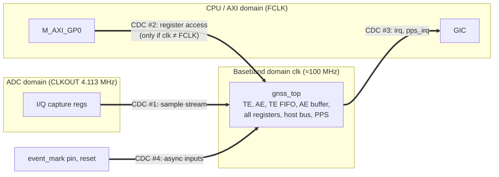

# Greta Oto on Zynq with MAX2771 — Clock Domains and Clock Domain Crossing (CDC)

This note adds the clock-domain and CDC analysis to `zynq_max2771_implementation_study.md`. It answers one question: when the correlators (baseband) run on a clock tied to the front end while the CPU reads and writes registers on its own clock, where are the clock-domain crossings, and how should each be implemented?

> **Caveat.** The MAX2771 and Zynq interface details (CLKOUT behaviour, GIC input behaviour) are from general knowledge. Check them against the datasheets and the Zynq TRM (UG585). No CDC tool was run. The RTL observations below come from reading the code.

---

## 1. Key point: the correlators do not run at the front-end sample clock

In Greta Oto the correlators **cannot** run at fs = 4.113 MHz. They run on a fast **baseband clock** (`clk`, about 100 MHz) that is 20–60× the sample rate:

| Block | How it uses `clk` | Cycles needed per 1 ms of signal |
|---|---|---|
| Tracking engine | Four physical correlators are time-shared by 32 logical channels. Each 1 ms FIFO block (4113 samples) is processed 8 times (4 channels per pass), at one sample per clock. | 8 × (4113 + a few hundred) ≈ **35,000** |
| Acquisition engine | Matched filter on **stored** samples, 2 cycles per sample per pass | Independent of real time (§4.4 of the main study) |
| Sample clock | 4.113 MHz | only **4,113** available |

So the whole baseband, including correlators, TE/AE state machines, the TE FIFO, the AE buffer, all registers and the host bus, sits in **one synchronous `clk` domain** in the existing RTL. The front-end clock is used only to **deliver samples**, and the CPU clock only to **deliver bus transactions**.

What the request "correlators on the front-end clock, registers on the CPU clock" can sensibly mean is that **`clk` is derived from the front-end reference (TCXO)** while the CPU accesses registers from the PS clock. That is Architecture B below, and it is a good choice. The CDC boundaries are then at the **edges** of `gnss_top`, never inside it:



---

## 2. Clock domain inventory

| Domain | Source | Frequency | Contents |
|---|---|---|---|
| ADC | MAX2771 CLKOUT (= TCXO ÷ 4) | 4.113 MHz (period 243.13 ns) | Capture registers for I1, I0, Q1, Q0 only |
| Baseband (BB) | Architecture A: PS FCLK_CLK0. Architecture B: MMCM from the TCXO | 100 MHz (A) or 98.712 MHz = 16.452 MHz × 6 (B) | All of `gnss_top` |
| CPU / AXI | PS FCLK_CLK0 (PS PLL from the PS crystal) | 100 MHz typ. | M_AXI_GP0 interface, AXI interconnect |
| GIC | PS internal | CPU_1x/CPU_6x4x | Interrupt inputs IRQ_F2P |
| Asynchronous inputs | Pins | — | `event_mark`, external reset |
| (Optional) PPS | Separate `pps_clk` with `pps_async.v` | — | Not recommended (§6) |

Frequency constraints from the RTL:

- **clk / fs must be at most 63.** The TE FIFO latches the time of an event as {write address, `data_clk_count`}, where `data_clk_count` is the number of `clk` cycles since the last sample. It is `CLK_COUNT_WIDTH = 20 − ADDR_WIDTH = 6` bits wide. At 4.113 MHz this limits `clk` to about 259 MHz.
- **clk / fs must be at least about 4** with the existing `sync_data.v`. With the CDC #1 implementation proposed below, at least about 6.
- **TE throughput** needs `clk` ≥ about 40 MHz for 32 channels at 4.113 Msps. 100 MHz gives about 65% margin.

---

## 3. Architecture options

| | A. Single clock (BB = FCLK) | **B. BB clock from TCXO + AXI clock converter** | C. BB = FCLK, PPS on TCXO (`pps_async.v`) |
|---|---|---|---|
| BB clock | FCLK_CLK0, 100 MHz | MMCM: 16.452 MHz × 60 / 10 = **98.712 MHz = 24 × fs** | FCLK_CLK0 |
| CDC #1 (samples) | async (ADC ↔ FCLK) | **mesochronous** (same TCXO, fixed but unknown phase) | async |
| CDC #2 (registers) | **none** | AXI4-Lite clock converter (FCLK ↔ BB) | none for BB; PPS registers cross inside `pps_async` |
| PPS time base | FCLK (PS crystal, tens of ppm, unrelated to receiver time) → firmware must steer every second | **TCXO-coherent**: PPS counter, sample clock and LO share one reference | TCXO |
| Sample spacing in `clk` cycles | 24.3 on average, jitters 24/25 | **exactly 24** | 24.3 on average |
| Extra hardware | none | TCXO → PL buffer (clipped sine to CMOS), 1 MMCM, AXI clock converter | none, but `pps_async.v` needs CDC fixes (§6) |
| Bring-up complexity | lowest | medium (BB clock exists only once the TCXO runs) | medium |
| Recommended for | Navigation-only, first bring-up | **Final design, timing/PPS users, and the stated intent of this request** | — |

**Recommendation.** Build the design so that A and B differ only in the clock source and the presence of the AXI clock converter: one top-level parameter, with identical CDC #1, #3 and #4 logic. Bring up with A, and switch to B once the TCXO feed to the PL is available.

Why the MMCM is fed from the TCXO and not from CLKOUT: the 7-series MMCM input must be at least 10 MHz (PLLE2: at least 19 MHz), so the 4.113 MHz CLKOUT can't drive it. The 16.452 MHz TCXO can, with VCO = 987.12 MHz (inside 600–1200 MHz for -1 parts) and ÷10 → 98.712 MHz. The TCXO's clipped-sine output needs a buffer or comparator (or an LVCMOS-output TCXO with a fan-out buffer) to drive both the MAX2771 and an FPGA clock-capable pin.

---

## 4. CDC #1 — sample stream (ADC → BB)

### 4.1 Requirements

- **Lossless and duplicate-free.** The sample count *is* the receiver's time base: TE FIFO addresses, AE time tags and measurement epochs. A lost or doubled sample is a time jump.
- **Fixed latency** from ADC to BB. Then `em_latch`/`pps_latch` timestamps in the TE FIFO keep a constant offset that can be calibrated.
- **Coherent multi-bit transfer.** All 4 bits of an I/Q sample must come from the same ADC clock edge.

### 4.2 Problem with the existing `sync_data.v`

`sync_data` samples both `adc_clk` and `adc_data` directly with `clk` and captures `data_d1` (pin data delayed by 2 `clk` flops) when it sees a rising edge on the synchronized clock. In terms of the ADC clock, the data is therefore sampled **about 1–2 `clk` cycles after the ADC clock's rising edge reaches the PL**. If the MAX2771 changes its outputs on the rising edge of CLKOUT (plus clock-to-out delay), that capture can land in the transition window. The result is a **mixed sample** with bits from two different ADC samples. It is not only a metastability risk but a data-coherence error that no synchronizer depth fixes. The module also has no timing constraint that guarantees the relationship.

### 4.3 Recommended implementation: hold register + synchronized qualifier

The sample rate is low (ratio of about 24), so a **multi-cycle "stable data + synchronized strobe"** transfer is simpler and has more margin than an async FIFO:

```
ADC domain (CLKOUT)                    BB domain (clk)
-------------------                    ---------------
IOB regs on correct CLKOUT edge
   |  {I1,I0,Q1,Q0}
   v
hold_reg[3:0]  <= iob_regs  ------------------------------+  (stable for 1 ADC period)
toggle         <= ~toggle   --> 2-3 FF sync (ASYNC_REG) --+--> edge detect --> capture hold_reg
                                                                     |            (multi-cycle path)
                                                                     v
                                                          sample_valid (1 clk) +
                                                          sample_data = {I1,00,I0,Q1,00,Q0}
```

1. **I/O capture.** Register I1/I0/Q1/Q0 in IOB flip-flops on the CLKOUT edge where the MAX2771 data is stable. Derive it from the datasheet output timing, or use the opposite edge to the launch edge. Constrain with `set_input_delay` relative to CLKOUT.
2. **Hold register and toggle.** Each ADC cycle, update `hold_reg` and flip `toggle`. `hold_reg` then stays stable for one ADC period (243 ns ≈ 24 `clk` cycles).
3. **BB side.** A 3-stage synchronizer on `toggle` (`ASYNC_REG = "TRUE"`), then XOR edge detection, gives one `sample_valid` pulse. In that same cycle, capture `hold_reg`. The synchronizer latency is 3–4 `clk` cycles, far less than the 24-cycle data stability window, so the multi-bit capture is safe.
4. **Constraints.** `set_max_delay -datapath_only` of about 2 `clk` periods from `hold_reg` to the BB capture register, plus `set_bus_skew` on `hold_reg`. Without these, Vivado can route them arbitrarily long.
5. **Output.** `sample_valid`/`sample_data` drive `gnss_top` through a bypass of `sync_data` (port option or `ifdef`). The 2-bit → 4-bit sign/magnitude mapping is wiring (main study §5.1).

This is functionally the same as `xpm_cdc_handshake` without the acknowledge path, which is unnecessary because the source rate is fixed and slow. Using `xpm_cdc_handshake` (or an `xpm_fifo_async` 8 bits × 16 deep) is an acceptable drop-in if a library-certified CDC primitive is preferred. Its constraints are generated automatically.

Diagnostics to add (cheap and useful during bring-up), as sticky flags in a status register:

- **Toggle overrun:** two toggles seen without an intervening capture. Impossible in a correct design.
- **Sample counter:** counts `sample_valid`, latched at each PPS, to check 4,113,000 ± TCXO error per second.

### 4.4 Architecture B (mesochronous) note

In B, CLKOUT = TCXO ÷ 4 and `clk` = TCXO × 6, so a sample arrives exactly every 24 `clk` cycles. Their phase relation is fixed after MMCM lock but unknown: it includes the MAX2771 internal divider and output delays. **Keep the same CDC circuit** and treat the crossing as asynchronous (`set_clock_groups -asynchronous`). It costs nothing, and it is robust to phase drift over temperature and to MMCM relock. The benefit of B shows up afterwards: `sample_valid` arrives at a constant cadence, and `data_clk_count` in the TE FIFO becomes an exact 1/24-sample fractional timestamp.

---

## 5. CDC #2 — register access (CPU/AXI → BB)

### 5.1 Architecture A: no crossing

The AXI4-Lite → host-bus bridge, `gnss_top` and the GP0 port all run on FCLK_CLK0. The bridge only has to meet the native bus protocol (main study §8 item 5): one-cycle `host_rd`/`host_wr`, read data on the next cycle, and `host_addr` held during that cycle.

### 5.2 Architecture B: crossing in AXI, never in the native bus

**Do not cross the native host bus (`host_cs/rd/wr/addr/d4wt/d4rd`) bit by bit.** Its strobes are single-cycle and many writes have one-shot side effects: `start_te`, soft resets, `latch_fifo`, interrupt clear, AE start.

```
PS GP0 (FCLK) --AXI4-Lite--> AXI Clock Converter (async) --AXI4-Lite--> AXI-Lite→host bridge --host bus--> gnss_top
                              (FCLK | BB)                                 (BB domain)            (BB domain)
```

- Use the **Xilinx AXI Clock Converter IP** in asynchronous mode (or `axi_interconnect` / SmartConnect with a separate clock on the slave side). Each AXI channel crosses through its own async FIFO and handshake. The bridge then produces **exactly one** `host_wr` pulse per AXI write and one `host_rd` per read, all inside the BB domain.
- If a small custom CDC is preferred: in the FCLK domain, latch the request (address, write data, read/write) into hold registers. Send a request toggle across with a 2–3 FF synchronizer, run the single bus cycle in the BB domain, then return read data in a hold register with an acknowledge toggle back to FCLK. This is `xpm_cdc_handshake` in each direction. Never start a new request before the acknowledge returns.
- **Cost:** about 300–600 LUT/FF for the AXI-Lite converter, and about 10–20 extra FCLK cycles of latency per access. GP0 accesses already take about 20–30 FCLK cycles, so the slowdown is about 1.5–2×. The firmware touches the baseband a few hundred times per ms at most (TE state/coherent data, AE results), so the extra CPU load stays small. Use bulk-read helpers (`LoadMemory`) and avoid read-modify-write loops in the ISR.

### 5.3 Bring-up hazard specific to B: the BB clock may not exist

In B, the BB clock exists only when the TCXO runs and the MMCM is locked. An AXI transaction into the converter while the BB side is unclocked or held in reset **stalls forever and hangs the CPU**. Mitigations, all recommended:

1. Route `mmcm_locked` and a "BB reset released" flag to a **CPU-domain** status register (AXI GPIO). The firmware polls it after `EnableRF()` and before any baseband access.
2. Hold the BB domain in reset (`proc_sys_reset` with `dcm_locked = mmcm_locked`) until lock. On loss of lock, interrupt the CPU.
3. Optional: put an **AXI timeout/firewall** in front of the converter (e.g. AXI Firewall IP, or a small watchdog that returns `SLVERR`), so a dead BB clock causes a bus error instead of a hang.

### 5.4 Ordering and visibility rules (both architectures)

These are not metastability issues, but they become visible once there is an interconnect or a converter in the path:

- **Write → read dependencies.** AXI read and write channels are independent, so a read can overtake an earlier write. Where the firmware writes and then reads something that depends on it, put `__DSB()` after the write, or **read back the written register** before continuing. Examples:
  - `GLB_FIFO_CLEAR` latch, then read `TE_FIFO_LWADDR_CPU`
  - `PPS` CPU latch, then read `PPS_CLK_COUNT_LATCH_CPU`
  - clear `GLB_INTERRUPT_FLAG`, then return from the ISR
- **Interrupt clear before ISR exit.** `irq` is a level output that drops only after the clear write reaches the BB domain and the deassertion propagates back to the GIC. Read back `GLB_INTERRUPT_FLAG` (or any baseband register) after clearing, then exit the ISR. Otherwise the CPU re-enters the ISR on a stale level.
- **TE buffer access window.** The host may access the TE state/coherent buffer only while the TE waits for the CPU (`tracking_engine.v` gives the TE engine priority over the host in FILL/CORRELATION/COHERENT_SUM/DUMP). This is an existing RTL rule, independent of the clocks, but extra access latency in B makes it more important to finish buffer accesses before re-triggering the TE (`GLB_TRACKING_START`).
- **Multi-word values.** Each 32-bit register read is atomic. Multi-register snapshots are consistent only through the latch mechanisms (`*_LWADDR_*`, `*_LATCH_*`). Keep using them.

---

## 6. CDC #3 — outputs to the CPU (interrupts) and PPS

### 6.1 Interrupts

| Signal | Behaviour in RTL | Connection | Notes |
|---|---|---|---|
| `irq` | Level: `|(int_flag & int_mask)`, held until cleared by register write | IRQ_F2P[0], **level-high** | Safe for an asynchronous receiver. Drive it from a flip-flop (no combinational glitches on an asynchronous path). Today it is an AND/OR of flops; register it once in the BB domain. |
| `pps_irq` | `pps_event & int_enable`; `pps_event` is held for 32 `clk` cycles (about 320 ns) | IRQ_F2P[1], **rising edge** | The 32-cycle pulse is long compared with the GIC sampling clock, so it is reliably detected. Register the AND output. Alternatively make it level-type with a flag in `GLB_INTERRUPT_FLAG`. |

Add `set_false_path -to` (or `set_max_delay -datapath_only`) for paths into IRQ_F2P. The PS synchronizes these inputs internally (check UG585). If in doubt, a 2-FF synchronizer on the FCLK side is harmless for level interrupts.

### 6.2 PPS generation and `pps_async.v`

- **`pps.v` (used today)** runs entirely in `clk` and needs no CDC.
  - In A, its counter ticks on FCLK, which is unrelated to the TCXO. `PPS_PULSE_INTERVAL` (nominal 100,000,000) and `PPS_PULSE_ADJUST` must be steered every second using `PPS_CLK_COUNT_LATCH_*` and the TE FIFO `pps_latch` timestamp. The registers were designed for this, but PPS jitter includes FCLK jitter and the steering residual.
  - In B, the counter ticks on the TCXO-coherent 98.712 MHz clock: nominal interval 98,712,000, and steering only has to remove the TCXO frequency error. PPS resolution is 10.13 ns.
- **`pps_async.v`** (separate `pps_clk`, not instantiated in `gnss_top`) has CDC weaknesses. Don't use it as-is:
  1. `host_d4rd` reads `pps_clk`-domain registers combinationally from `clk`. Static configuration registers are fine, but `clk_count_latch_*` / `pulse_count_latch_*` can update during a read and give a torn 31-bit value. Fix with a handshake snapshot, or have the firmware read twice and compare.
  2. Writes use a toggle with **no acknowledge**. `write_addr`/`write_data` are overwritten by a second host write before the `pps_clk` domain has consumed the first, if writes arrive faster than about 3 `pps_clk` cycles apart. Fix with a busy flag or a small async FIFO.
  3. `pps_event` and `pps_irq` leave the `pps_clk` domain unsynchronized into `te_fifo` (`pps_latch`, `clk` domain) and the interrupt logic. A 2-FF synchronizer is needed. The 32-cycle hold makes the pulse wide enough to synchronize.

  Architecture B makes `pps_async.v` unnecessary, because the PPS counter is already in a TCXO-coherent domain.

---

## 7. CDC #4 — asynchronous inputs and resets

| Item | Current RTL | Required change |
|---|---|---|
| `event_mark` → TE FIFO `em_latch` (`gnss_top.v`) | One flop (`event_mark_latch`) followed by edge detection. The raw pin also enters the AND gate directly, so the rising-edge pulse can be metastable or glitchy | 2–3 FF synchronizer (`ASYNC_REG`) first, then edge detection on synchronized signals only. The timestamp gets 2–3 cycles (about 30 ns) of fixed latency, which can be calibrated. Note that `pps.v`'s own `event_mark` input is wired to the internal `pps_pulse3` loop-back in `gnss_top`, so it is synchronous. If an external pin is ever connected there, add the same synchronizer. |
| External/PS reset | async active-low `rst_b` | One `proc_sys_reset` (asynchronous assert, synchronous release) **per domain**: ADC, BB (gated by `mmcm_locked` in B), FCLK |
| Soft resets `reset_ae`, `reset_te`, `reset_fifo` | **Combinational decode** of host strobe, address and data, ANDed into the async reset pin (`rst_b && ~reset_ae`). Glitches on the decoder can cause spurious resets | Register the decoded reset pulse. Combine it with the synchronized `rst_b` and pass it through a reset synchronizer, so assertion is clean and release is synchronous to `clk`. Constrain with `set_false_path` / reset recovery as appropriate |
| ADC-domain reset | none | Reset the capture/toggle logic from a synchronized reset in the ADC domain. Release it before the BB side starts accepting samples. Clear the TE FIFO (`GLB_FIFO_CLEAR`) after the first stable samples |

Internal gated clocks (`gated_clock_wrapper`: 1 in `ae_core`, 4 in `tracking_engine`) aren't CDC. As a pass-through they are the same clock. If they map to `BUFGCE`, they become synchronous derived clocks of `clk`, timed together by Vivado. Never synthesize the latch + AND model.

---

## 8. Constraints (XDC sketch)

```tcl
# ---- clocks ----
create_clock -name adc_clk  -period 243.131 [get_ports max_clkout]      ;# 4.113 MHz
create_clock -name tcxo_clk -period  60.783 [get_ports tcxo_in]         ;# 16.452 MHz (Arch. B)
# FCLK_CLK0 and the MMCM outputs are created automatically by the PS7 / clocking wizard IP

# ---- ADC data input (example numbers; take tCO from the MAX2771 datasheet) ----
set_input_delay -clock adc_clk -max <tco_max> [get_ports {max_i1 max_i0 max_q1 max_q0}]
set_input_delay -clock adc_clk -min <tco_min> [get_ports {max_i1 max_i0 max_q1 max_q0}]
set_property IOB TRUE [get_cells -hier *adc_iob_reg*]

# ---- asynchronous domains ----
set_clock_groups -asynchronous \
  -group [get_clocks adc_clk] \
  -group [get_clocks -of_objects [get_pins u_bb_mmcm/inst/mmcm_adv_inst/CLKOUT0]] \
  -group [get_clocks clk_fpga_0]
# (Arch. A: drop the MMCM group; BB uses clk_fpga_0)

# ---- CDC #1: sample hold register -> BB capture (multi-cycle, bounded) ----
set_max_delay -datapath_only -from [get_cells -hier *hold_reg*] -to [get_cells -hier *bb_sample_cap*] 20.0
set_bus_skew  -from [get_cells -hier *hold_reg*] -to [get_cells -hier *bb_sample_cap*] 5.0
set_property ASYNC_REG TRUE [get_cells -hier *toggle_sync_reg*]

# ---- CDC #4: event_mark synchronizer ----
set_property ASYNC_REG TRUE [get_cells -hier *em_sync_reg*]
set_false_path -from [get_ports event_mark]

# ---- PPS outputs ----
set_property IOB TRUE [get_cells -hier *pps_signal*_reg]
```

XPM CDC macros and the AXI Clock Converter IP add their own scoped constraints. Don't duplicate them.

Sign-off checks:

- `report_cdc -details`: no "Unsafe" or "Unknown" crossings; every crossing is one of the intended four.
- `report_clock_interaction`: all inter-domain paths are covered by an asynchronous group or a bounded max delay.
- `report_methodology`: no TIMING-* warnings about missing synchronizers or `ASYNC_REG`.

---

## 9. Verification plan for CDC

1. **Simulation with independent clocks.**
   - Run the ADC clock at 4.113 MHz ± 50 ppm and FCLK at 100 MHz ± 50 ppm, with random phase and jitter.
   - Check that every ADC sample appears exactly once at `sample_valid`, in order (scoreboard with a sample counter embedded in test data).
   - In B, repeat with 24:1 locked clocks and several phase offsets.
2. **Register-path simulation (B).** Drive AXI transactions through the clock converter with random gaps and check exactly-once semantics of side-effect writes (`start_te`, latch, interrupt clear). Then run the `ModelRun` reference flow through RTL.
3. **Static checks.** `report_cdc`, methodology, and optionally a formal CDC tool if available.
4. **On hardware:**
   - Samples per PPS (expected 4,113,000 × (1 + TCXO error)).
   - Sticky overrun/error flags never set over long runs.
   - ILA on the capture path at several temperatures (heat gun / freezer spray) to show margin.
   - In B, unplug or stop the TCXO and confirm the CPU doesn't hang (§5.3).

---

## 10. Summary of changes

| # | Change | Domain(s) | Cost |
|---|---|---|---|
| 1 | Replace `sync_data` with an IOB capture + hold register + toggle-synchronizer front end (or `xpm_cdc_handshake` / `xpm_fifo_async`) feeding `sample_valid`/`sample_data` directly | ADC → BB | < 100 LUT/FF |
| 2 | Architecture B only: MMCM from the TCXO (98.712 MHz = 24 × fs), AXI Clock Converter between GP0 and the AXI-Lite→host bridge, `mmcm_locked` status in the CPU domain, optional AXI timeout | FCLK ↔ BB | 1 MMCM, about 300–600 LUT/FF |
| 3 | Register `irq` and `pps_irq` before leaving the BB domain; level/edge GIC configuration | BB → GIC | negligible |
| 4 | 2–3 FF synchronizer on `event_mark` before edge detection | pin → BB | negligible |
| 5 | Registered, synchronized soft resets; one reset synchronizer per domain, BB reset gated by MMCM lock | all | negligible |
| 6 | Don't use `pps_async.v` without fixing read snapshot, write acknowledge and `pps_event` synchronization (not needed with B) | — | — |
| 7 | Firmware: DSB or read-back for write → read dependencies, read back after interrupt clear, check MMCM lock before baseband access (B), keep TE buffer accesses inside the CPU-wait window | CPU | — |
| 8 | XDC: clock definitions, asynchronous groups, bounded max delay and bus skew on the sample hold register, `ASYNC_REG`, IOB, CDC sign-off reports | — | — |
