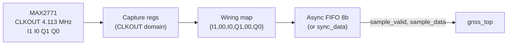
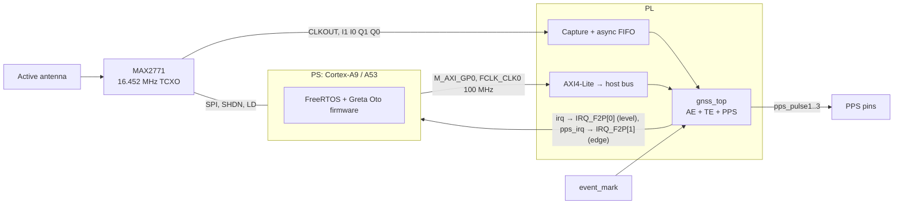

# Greta Oto on AMD Zynq with a MAX2771 Front End — Implementation Study

This study replaces the MAX2769 (I-only, 16.368 Msps, 4.092 MHz IF; see `max2769/zynq_max2769_implementation_study.md`) with a **MAX2771** configured to match the reference setup the Greta Oto baseband and firmware were designed and verified for:

| Item | Value |
|---|---|
| RF band | GPS/QZSS L1 C/A and L1C, SBAS L1, Galileo E1, BDS B1C (1575.42 MHz) |
| Front-end output | **Complex I/Q, 2 bits each** (sign + magnitude) |
| Sampling frequency | **4.113 MHz** (same as `SAMPLE_FREQ` in `Firmware/common/CommonDefines.h`) |
| IF | **+141 kHz** (same as `IF_FREQ`) |
| LO | **1575.279 MHz** (= 383 × 4.113 MHz, low-side) |
| Recommended reference (TCXO) | **16.452 MHz** (= 4 × 4.113 MHz) |

**Signals covered.** All L1-band signals the repository supports share the 1575.42 MHz carrier, so one front-end setting serves all of them. Nothing in this study is specific to GPS L1 C/A; C/A is only the first step of the bring-up (§10).

| Signal | Modulation (transmitted) | Received component | Notes |
|---|---|---|---|
| GPS / QZSS L1 C/A | BPSK(1) | Full | QZSS L1 C/A is identical in structure to GPS L1 C/A (Gold codes, same AE/TE path) |
| SBAS L1 | BPSK(1) | Full | Same code family and path as L1 C/A |
| Galileo E1 B/C | CBOC(6,1,1/11) | BOC(1,1) part only | Needs the E1 memory-code ROM (§6.2) |
| BDS B1C data / pilot | BOC(1,1) / QMBOC(6,1,4/33) | BOC(1,1) part only | Uses the B1C Legendre ROM |
| GPS / QZSS L1C data / pilot | BOC(1,1) / TMBOC(6,1,4/33) | BOC(1,1) part only | Uses the L1C Legendre ROM |

The BOC(6,1) components of the MBOC signals (lobes near ±6.1 MHz) are outside the ±2.05 MHz band of this front end. The correlator also generates only a BOC(1,1) replica (`HWModel/src/Correlator.cpp`, `EnableBOC & CodeSubPhase`). So these signals are received through their BOC(1,1) part, with a small fixed loss in correlation power:

| Component | BOC(1,1) power fraction | Loss |
|---|---|---|
| Galileo E1-B and E1-C | 10/11 | ≈ 0.4 dB |
| B1C pilot, L1C pilot | 29/33 | ≈ 0.6 dB |
| B1C data, L1C data | 1 | 0 dB |

These figures do not include the extra band-limiting loss on the BOC(1,1) main lobes from the ±2.05 MHz filter, which BOC signals suffer more than BPSK. The loss comes from the original 4.113 Msps design, not from the MAX2771. Recovering it would need about ±7 MHz of bandwidth and a much higher sample rate, which the baseband was not designed for.

> **Caveats.** MAX2771 register names, divider ranges and filter options below are from general knowledge of the MAX2769/MAX2771 family. **Check every register value against the MAX2771 datasheet before use.** No FPGA tool was run: memory figures come straight from the RTL and are exact, while LUT/FF figures are hand estimates (±30%).

---

## 1. Summary of conclusions

1. **The MAX2771 fits the baseband almost directly.** With complex 2-bit I/Q at 4.113 Msps and a 141 kHz IF, the input matches the format of `if_data/all_signal.bin` and the assumptions behind the firmware tables. **No DSP adapter is needed.** A 2-bit sign/magnitude sample maps to the baseband's 4-bit sign/magnitude format by **wiring only**:
   `adc_data[7:0] = {I_sign, 2'b00, I_mag, Q_sign, 2'b00, Q_mag}`, so the levels are ±1 and ±3.
2. **Choosing the LO and reference.** The original numbers fit together exactly: **LO = RF − IF = 1575.420 − 0.141 = 1575.279 MHz = 383 × 4.113 MHz.** So both the LO and the sample clock can come from one reference with **integer-only ratios**:
   - Use a **16.452 MHz TCXO** (4 × fs).
   - PLL in integer-N mode: R = 4 → comparison frequency 4.113 MHz, N = 383 → LO = 1575.279 MHz exactly.
   - ADC clock = reference ÷ 4 = 4.113 MHz exactly.

   No fractional-N spurs, no fractional-divider clock jitter, and IF = 141 kHz exactly (scaled by the TCXO error). Section 3 covers alternatives such as standard 16.368 MHz TCXOs. If a catalogue TCXO is preferred, a **16 MHz TCXO with fs = 4.000 MHz and IF = +147.27 kHz** (integer-N R = 11, N = 1083) keeps nearly all properties of the original plan; only the firmware constants change (§3.4).
3. **Baseband RTL: functionally unchanged.** TE FIFO depth (2.49 ms), TE load (about 35% of a 100 MHz clock), AE rate-adaptor filtering and the AE code-rate ratio all work as designed. The FPGA-specific changes are the same as for any FPGA build: clock gating, ROM init files, AXI4-Lite bridge, input capture/CDC and constraints.
4. **Firmware: frequency constants unchanged.** `SAMPLE_FREQ 4113000` and `IF_FREQ 141000` are already the defaults, and the loop-filter tables (computed for fs = 4113 kHz) and the TE block size (4113) are already correct. What is left is platform work: HW access layer fixes, interrupt hookup, MAX2771 SPI driver, and retuning amplitude-dependent constants such as `AE_THRESHOLD` and the CN0/noise calibration for 2-bit input.
5. **Acquisition engine requirements (unchanged by the front end):** about **40.5 RAMB36** (1,231,360 bits; the 128 ms sample buffer is 32 of them), about **12k FF, about 10k LUT, 8 DSP48**. The whole receiver needs about 20–23k LUT and about 58 RAMB36, so **XC7Z020 is the smallest comfortable Zynq-7000**. XC7Z010 is too small in LUTs and nearly full in BRAM.

---

## 2. Repository recap (relevant points)

The baseband is described in detail in the MAX2769 study, §2. The points that matter for front-end integration are:

- **ADC interface of `gnss_top`.** Ports `adc_clk` and `adc_data[7:0]`; I is in [7:4] and Q in [3:0]. Each nibble is sign/magnitude: bit 3 is the sign (0 = positive) and bits [2:0] give the magnitude m, standing for the level 2m+1 (1, 3, …, 15). `sync_data.v` re-samples `adc_clk` and `adc_data` with the system `clk` and gives a one-cycle `sample_valid`.
- **Both TE and AE consume the same stream.** The TE goes through the TE FIFO (10240 samples, 1 ms blocks of `TE_FIFO_BLOCK_SIZE` = 4113 samples). The AE goes through `rate_adaptor` (carrier NCO, 6-tap FIR, decimation to 2.046 Msps, 2-bit re-quantization) into the 32768 × 32 AE buffer.
- **Rate-dependent constants.** These are all derived for fs = 4.113 MHz in the current code:
  - `SAMPLE_FREQ`, `IF_FREQ`, `SAMPLES_1MS`
  - the literal 4113 in `FirmwarePortal.c`
  - `FilterCoef*` in `TrackingLoop.c` ("Kn·2³³/fs, fs = 4113")
  - `AE_CODE_RATIO = 2.046e6/SAMPLE_FREQ·2²⁴`

---

## 3. Frequency plan: which LO and reference to choose

### 3.1 Why 4.113 MHz and 141 kHz

| Property | Value | Significance |
|---|---|---|
| fs / chip rate | 4113 / 1023 = 1371/341 = 4.0205 | Not an integer, so the sampling isn't commensurate with the code. The sample-to-chip phase pattern repeats only every 341 chips (resolution 1/341 chip ≈ 0.86 m), which avoids the code-discriminator staircase seen with exactly 4 samples/chip. |
| LO / fs | 1575.279 / 4.113 = **383** exactly | LO and ADC clock can share one reference with integer dividers. |
| Complex IF = +141 kHz | small, non-zero | Keeps the ADC DC offset and flicker noise away from 0 Hz carrier offset. An I/Q-imbalance image of a satellite lands at −141 kHz − Doppler, about 282 kHz from the true signal and far outside the Doppler search (about ±5 kHz), so it can't be mistaken for the signal. |
| AE rate-adaptor FIR | null at fs/2 = 2.0565 MHz ≈ 2.046 MHz | For BOC signals the AE shifts by 1.023 MHz to acquire one side lobe. The other lobe sits at −2.046 MHz and is nulled before decimation to 2.046 Msps. |

### 3.2 LO frequency

- **LO = 1575.279 MHz**, below the RF (low-side injection). In IQ mode this gives a **positive** complex IF of +141 kHz, which is what the firmware's `IF_FREQ` and Doppler sign convention expect (`MsrProc.c`: Doppler = carrier NCO frequency − `IF_FREQ`).
- High-side injection (LO = 1575.561 MHz) would give IF = −141 kHz, a spectrally inverted complex signal. It could be undone by swapping the I and Q wires in the PL, but there is no reason to choose it. Swapping I/Q in the PL is still a useful cheap way to fix a polarity mistake.

### 3.3 Reference (TCXO) frequency

Requirements:

- the LO must be an exact integer-N multiple of the comparison frequency (f_ref / R)
- the ADC clock must be an exact integer division of f_ref
- f_ref must be within the MAX2771 reference input range (roughly 10–44 MHz; check the datasheet)

| TCXO | PLL setting | ADC clock | LO error | Assessment |
|---|---|---|---|---|
| **16.452 MHz (4 × fs)** | Integer-N, R = 4, N = 383 (f_comp = 4.113 MHz) | f_ref ÷ 4 (reference divider / integer clock divider) | **0** | **Recommended.** Everything is exactly coherent with integer ratios. Usually a custom frequency (many TCXO vendors offer arbitrary frequencies with an MOQ). |
| 32.904 MHz (8 × fs) | Integer-N, R = 8, N = 383 | f_ref ÷ 8 (integer clock divider) | 0 | Equivalent alternative if the ÷4 path isn't available but an integer ÷8 is. |
| 12.339 / 20.565 / 24.678 MHz (3×, 5×, 6× fs) | Integer-N, R = 3/5/6, N = 383 | f_ref ÷ 3/5/6 | 0 | Fine if the MAX2771 clock divider supports these ratios. |
| 16.368 MHz (standard GPS TCXO) | Fractional-N: N = 96, F ≈ 0.241386 (20-bit F = 253,111) | Fractional clock divider: fs/f_ref = 1371/5456. With a MAX2769-style divider f = f_ref·L/(4096 − M + L), this gives L = 1371, M = 11 | about 3 Hz (F quantization, step 15.6 Hz) | **Not recommended.** The fractional clock divider makes a non-uniform sample clock (period jitter of about one reference cycle, 61 ns, against a 243 ns sample period). Fractional-N spurs are also possible. |
| 16.368 MHz with fs = 4.092 MHz (÷4) | Integer-N, LO = 1575.279 not reachable exactly | 4.092 MHz | — | Changes fs to exactly 4 samples/chip (commensurate), the case 4.113 MHz was chosen to avoid. Firmware tables would also need recomputing. |

**Answer:** the LO should be **1575.279 MHz**. The best reference is a **16.452 MHz TCXO** (or any integer multiple of 4.113 MHz that the MAX2771 can divide down), with the synthesizer in **integer-N mode, R = 4, N = 383**, and the ADC clock = **reference ÷ 4**.

TCXO stability: a TCXO error ε shifts fs, LO and IF together. The IF moves by −1575.279 MHz × ε (e.g. −1.6 kHz for +1 ppm) and fs by 4.113 MHz × ε. The receiver clock-drift estimate absorbs this, exactly as for the original design. Use a ±0.5–2 ppm GNSS-grade TCXO.

### 3.4 Plans using standard TCXO frequencies

**Why no standard frequency hits 4.113 MHz.** 4113 kHz = 3² × 457 kHz, and 457 is prime. Every reference that gives fs = 4.113 MHz by integer division must be a multiple of 4.113 MHz (8.226, 12.339, 16.452, 20.565, 24.678, 28.791, 32.904, 37.017, 41.130 MHz, …). None of these is a catalogue TCXO frequency; the usual ones are 10, 12.8, 16, 16.368, 19.2, 20, 24, 26, 30.72, 38.4 and 40 MHz. The only ways to keep exactly 4.113 MHz with a standard TCXO are the fractional clock divider (§3.3, not recommended) or a custom TCXO.

**Changing fs instead.** If fs is allowed to differ from 4.113 MHz, a standard TCXO works well, as long as the new plan keeps the properties that made 4.113 MHz good:

| Requirement | Reason |
|---|---|
| fs = f_ref / integer | Uniform sample clock (no fractional-divider jitter) |
| fs a multiple of 1 kHz | `CommonDefines.h` rejects anything else: 1 ms blocks must be a whole number of samples |
| fs / 1.023 MHz far from a simple ratio | Avoids code-phase quantization (4.092 Msps = exactly 4 samples/chip is the bad case; 5.456 Msps = 16/3 repeats every 3 chips) |
| fs ≈ 4–5.5 MHz | Complex Nyquist ±fs/2 must cover the BOC(1,1) band (±2.05 MHz around the IF). TE load and FIFO depth must stay reasonable |
| LO from the same reference in integer-N mode, IF ≈ 30–200 kHz | Exact, spur-free LO. IF small but away from DC, as in the original (141 kHz) |

Candidate plans (searched over integer R and N; IF = 1575.42 MHz − N·f_ref/R):

| TCXO | ADC clock | fs | Samples/chip (pattern period) | PLL (integer-N) | LO | IF | TE load @100 MHz / FIFO depth | AE FIR @1.023 / @2.046 MHz |
|---|---|---|---|---|---|---|---|---|
| (reference) 16.452 MHz custom | ÷4 | 4.113 MHz | 4.0205 (341 chips) | R = 4, N = 383 | 1575.279 | +141.000 kHz | 35% / 2.49 ms | −5.5 / −39.9 dB |
| **16 MHz** | **÷4** | **4.000 MHz** | 3.9101 (1023 chips) | **R = 11, N = 1083** (f_comp 1.4545 MHz) | 1575.2727 | **+147.273 kHz** | 34% / 2.56 ms | −6.3 / −26.9 dB |
| 24 MHz | ÷6 | 4.000 MHz | 3.9101 (1023 chips) | R = 11, N = 722 (f_comp 2.1818 MHz) | 1575.2727 | +147.273 kHz | 34% / 2.56 ms | −6.3 / −26.9 dB |
| 20 MHz | ÷5 | 4.000 MHz | 3.9101 (1023 chips) | R = 17, N = 1339 (f_comp 1.1765 MHz) | 1575.2941 | +125.882 kHz | 34% / 2.56 ms | −6.3 / −26.9 dB |
| 19.2 MHz | ÷4 | 4.800 MHz | 4.6921 (341 chips) | R = 20, N = 1641 (f_comp 0.96 MHz) | 1575.360 | +60.000 kHz | 41% / 2.13 ms | −2.5 / −13.1 dB |
| 26 MHz | ÷5 | 5.200 MHz | 5.0831 (1023 chips) | R = 5, N = 303 (f_comp 5.2 MHz) | 1575.600 | −180.000 kHz → **+180 kHz after I/Q swap** | 44% / 1.97 ms | −1.6 / −13.0 dB |

**Recommendation for a standard part: 16 MHz TCXO, ADC clock ÷4 → fs = 4.000 MHz, integer-N R = 11 / N = 1083 → IF = +147.273 kHz.**
- It is the plan closest to the original design. Load, FIFO depth (2.56 ms) and AE FIR behaviour are almost unchanged, and the null at fs/2 = 2.0 MHz still suppresses the second BOC lobe in the AE (−27 dB at 2.046 MHz, against −40 dB originally).
- The sample/chip pattern repeats only every 1023 chips, which is even finer than 4.113 MHz (341 chips).
- No RTL change at all. Only the firmware constants change.
- ÷4 is the most likely clock-divider ratio to be available. 24 MHz (÷6) gives the same fs and IF with a higher comparison frequency (2.18 MHz, lower PLL phase noise) if the MAX2771 can divide by 6.
- The exact IF is 1.62/11 MHz = 147,272.73 Hz. With `IF_FREQ 147273` the residual is 0.27 Hz, which the clock-drift estimate absorbs.
- Nyquist is ±2.0 MHz, so the upper edge of the BOC band (+2.19 MHz) folds slightly, about 60 kHz more than with the original plan.

**26 MHz** (the most common TCXO of all) is the cleanest frequency plan:
- integer-N with a 5.2 MHz comparison frequency, LO = 303 × fs exactly (like the original 383 × fs), integer-Hz IF
- wider Nyquist band (±2.6 MHz)

Its drawbacks:
- The FIFO holds only 1.97 ms. Use the larger FIFO wrapper (`te_fifo_ram_6144x32_wrapper`).
- The AE FIR rejects the second BOC lobe less (−13 dB at 2.046 MHz).
- The LO is above the RF, so swap I and Q in the PL to make the IF positive.

**Firmware changes for any plan other than 4.113 MHz:**
- `SAMPLE_FREQ` and `IF_FREQ` in `CommonDefines.h`
- `TE_FIFO_BLOCK_SIZE` (the literal 4113 in `FirmwarePortal.c`; use `SAMPLES_1MS`)
- the loop-filter tables in `TrackingLoop.c` (scale by 4113/fs_kHz, or regenerate)
- `AE_THRESHOLD`

`AE_CODE_RATIO` and the carrier/code NCO words follow `SAMPLE_FREQ` automatically.

---

## 4. MAX2771 configuration (to verify against the datasheet)

| Function | Setting | Remarks |
|---|---|---|
| Band / LNA | L1 band input, active antenna via the antenna bias/LNA path | |
| Synthesizer | Integer-N, RDIV = 4, NDIV = 383 (with a 16.452 MHz reference) | LO = 1575.279 MHz; check the allowed comparison frequency and loop filter for 4.113 MHz |
| Mixer / IF mode | **IQ (complex) mode**, low IF | Both I and Q ADCs enabled |
| IF filter | Low-pass (or complex) setting whose passband covers about **±2.05 MHz** (BOC(1,1) main lobes) and rolls off by the complex Nyquist edge **±2.056 MHz**. For BPSK(1) signals only (GPS/QZSS L1 C/A, SBAS), use a narrower setting (about ±1.2 MHz). Do not narrow it if any BOC signal (E1, B1C, L1C) is to be received | Noise between ±2.056 MHz and the filter stopband folds back in. Pick the setting from the datasheet response curves. |
| ADC | **2 bits per channel (I1, I0, Q1, Q0), sign/magnitude format** | Sign/magnitude matches the baseband's nibble format, so the mapping is pure wiring. |
| ADC clock | 4.113 MHz = reference ÷ 4, also driven on CLKOUT | CLKOUT clocks the PL capture |
| AGC | On; target about 33% magnitude-bit occupancy | Standard optimum for 2-bit quantization (levels ±1, ±3, threshold near 1σ) |
| Control | 3-wire serial interface (CS, SCLK, SDATA), written by the PS at boot | Pins: CLKOUT, I1, I0, Q1, Q0, SPI, SHDN/IDLE, PLL lock (LD) if routed |

**Sign and orientation checks** (all fixable by wiring in the PL):

- If the MAX2771 uses sign = 1 for positive, invert the sign bit of **both** I and Q. Inverting both is only a 180° phase rotation, so it would actually be harmless. Still, keep the convention clean so the ADC statistics read sensibly.
- If the measured Doppler sign comes out wrong, the complex spectrum is mirrored. **Swap I and Q** (or invert Q only).

---

## 5. PL integration

### 5.1 Front-end interface (no DSP)

- **Bit mapping (2-bit sign/magnitude → 4-bit sign/magnitude):**

  | MAX2771 (sign, mag) | Level | Baseband nibble |
  |---|---|---|
  | (0, 0) | +1 | `0_000` |
  | (0, 1) | +3 | `0_001` |
  | (1, 0) | −1 | `1_000` |
  | (1, 1) | −3 | `1_001` |

  The level ratio 1:3 is close to the optimum for 2-bit quantization, so no gain stage is needed. With 3-bit output, the mapping `{s, 1'b0, m1, m0}` gives ±1…±7.
- **Clock-domain crossing.** At fs = 4.113 MHz and clk = 100 MHz the ratio is about 24, well within what `sync_data.v` assumes. Note, however, that `sync_data` uses `data_d1` from the cycle **before** the detected rising edge of the synchronized `adc_clk`. That is only safe if `adc_data` is stable around the CLKOUT rising edge, i.e. the MAX2771 changes data on the falling edge. Choose one of two options:
  - (a) **recommended:** capture I/Q in the CLKOUT domain on the correct edge, then pass the bytes through a small async FIFO (LUTRAM, 16 deep) and drive `sample_valid`/`sample_data` directly (add a bypass of `sync_data` in `gnss_top`); or
  - (b) keep `sync_data` and invert `adc_clk` in the PL if needed so that the detected edge falls in the middle of the data eye. Confirm the edge with an ILA during bring-up.
- Resources: under 100 LUT/FF and no BRAM or DSP.
- `clock_domain_crossing.md` in this directory has the full clock-domain and CDC analysis: sample stream, register access when the baseband clock is derived from the TCXO, interrupts, PPS, asynchronous inputs and resets, constraints and verification.

### 5.2 System architecture

- **Clocks.** `clk` = FCLK_CLK0 = 100 MHz for the AXI bridge and `gnss_top`, the value assumed by the C model (`AE_CLK_FREQ_MHz 100`). CLKOUT (4.113 MHz, period 243.1 ns) is used only in the capture logic.
- **Timing reference.** All measurements are in ADC samples, so the TCXO sets measurement quality. PPS resolution is one `clk` period (10 ns).
- **Alternative clocking.** The baseband `clk` can instead come from the TCXO through an MMCM (16.452 MHz × 6 = 98.712 MHz = 24 × fs), with the CPU reaching it through an AXI clock converter. This makes PPS and sample timing coherent with the TCXO. See `clock_domain_crossing.md` §3 (Architecture B).

---

## 6. Acquisition engine: requirements

The front end now delivers exactly the reference format, so **the AE is used exactly as designed**.

### 6.1 Operation at fs = 4.113 MHz

| Parameter | Value |
|---|---|
| `AE_CODE_RATIO` | round(2.046/4.113 × 2²⁴) = 8,345,778 (0.49745) |
| `AE_CARRIER_FREQ` | 141 kHz·2³²/fs (BPSK); (141 kHz + 1.023 MHz)·2³²/fs (BOC side lobe) |
| Rate-adaptor FIR (−5, 8, 20, 20, 8, −5) | +0.2 dB @ 0.5 MHz, −5.5 dB @ 1.023 MHz, −16 dB @ 1.5 MHz, **−40 dB @ 2.046 MHz** (null at fs/2) |
| AE buffer content | 2.046 Msps × 4 bit (2b I + 2b Q), 8 samples/word |
| Input amplitudes | Input is now 2-bit (±1, ±3) instead of the 4-bit IF file, so the FIR output distribution changes. **Retune `AE_THRESHOLD`** (firmware writes 37) for about 30–35% magnitude-bit occupancy in the AE buffer. |

### 6.2 RAM requirements (exact)

| Memory | Organization | Bits | Port | RAMB36 eq. |
|---|---|---|---|---|
| Sample buffer (`ae_sample_buffer_32768x32_wrapper`) | 32768 × 32 | 1,048,576 | single | **32** |
| Coherent buffer (`ae_coh_buffer_682x192_wrapper`) | 682 × 192 (8 bins × 24 b) | 130,944 | single | **5.5** |
| Non-coherent buffer (`ae_noncoh_buffer_682x64_wrapper`) | 682 × 64 (8 bins × 8 b) | 43,648 | single | **2** |
| Config/result buffer (`ae_config_buffer_256x32_wrapper`) | 256 × 32 | 8,192 | true dual | **1** |
| **AE total** | | **1,231,360** | | **≈ 40.5** |
| Shared with TE: Legendre ROMs | 2 × 640 × 16 | 20,480 | ROM | 1 |
| Shared with TE: Galileo E1 memory-code ROM | 12800 × 32 | 409,600 | ROM | 12.5–13 |

- The **sample buffer** holds 262,144 samples = 128 ms. The current firmware search modes use at most about 20 ms (B1C/L1C cold: 4 × 2 coherent/non-coherent plus a 30-round code span). Setting `AE_BUFFER_SIZE` to 8192 (32 ms, **8 RAMB36**) or 16384 (64 ms, 16 RAMB36) and building a matching RAM is enough. The firmware threshold (`ADDR_AE_BUFFER_CONTROL`) must then stay below the buffer length in ms.
- The **coherent/non-coherent buffers** are fixed by the 682-sample matched filter and can't be reduced without redesign.
- The **memory-code ROM** is needed only for Galileo E1. Leaving it out saves 12.5–13 RAMB36.

### 6.3 Logic requirements (estimate)

| Sub-block | FF | LUT | DSP48 |
|---|---|---|---|
| `rate_adaptor`, `ae_buffer_rw`, `read_sample` | ~410 | ~480 | 0 |
| MF sample shift register (681 × 12 b) | **8,172** (or ~4.1k SRL) | 0 | 0 |
| MF tap select (6 × 341 mux ⊕ code) | 0 | **~2,050** | 0 |
| MF adder trees (6 × 341-input popcount) + output | ~430 | **~2,620** | 0 |
| PRN double buffer + `ae_prn_gen` | ~830 | ~650 | 0 |
| Coherent path (DFT, block floating point) | ~1,000 | ~2,000 | **8** (2 pairs × 4 multipliers 16 × 10 b) |
| Non-coherent path + noise floor | ~600 | ~1,200 | 0 |
| Peak sorter, `ae_core`, `ae_top` | ~670 | ~1,100 | 0 |
| **AE total** | **≈ 12.1k** | **≈ 10.1k** | **8** |

The matched filter dominates. Put `max_fanout` on `calculate`, `iq_select` and the 341-bit code bus. Replace the latch-based `gated_clock_wrapper` (in `ae_core`) with a pass-through or `BUFGCE`.

### 6.4 Throughput at 100 MHz

The AE processes stored data, so throughput depends only on the clock: `cycles ≈ 682·S·R·(1 + 6·C·N)` per channel.

| Search | S | R | C | N | Time/SV | 32 SVs |
|---|---|---|---|---|---|---|
| L1 C/A cold | 19 | 3 | 4 | 1 | 9.7 ms | 0.31 s |
| L1 C/A warm | 3 | 3 | 4 | 1 | 1.5 ms | 49 ms |
| E1 cold | 19 | 12 | 4 | 2 | 76 ms | 2.4 s |
| B1C/L1C cold | 19 | 30 | 4 | 2 | 190 ms | 6.1 s |

Critical paths (tap select + `adder31`, the 11-operand add, the exponent normalize/add) should close at 100 MHz on -1 speed grade 7-series devices.

---

## 7. Whole-receiver budget and device choice

| Block | LUT | FF | DSP | RAMB36 |
|---|---|---|---|---|
| AE | ~10k | ~12k | 8 | 40.5 |
| TE (4 correlators, FIFO 2560 × 32, state buffer 1024 × 32) | ~8–12k | ~6–8k | 0–4 | 4 |
| Shared ROMs | — | — | — | 13.5 |
| PPS, globals, arbiters | ~0.7k | ~0.6k | 0 | 0 |
| Front-end capture, AXI bridge, SPI/GPIO | ~0.4k | ~0.4k | 0 | 0 |
| **Total** | **≈ 19–23k** | **≈ 19–21k** | **8–12** | **≈ 58** |

TE timing at 4.113 Msps: 8 channel groups × (4113 + a few hundred cycles) ≈ 35k cycles per 1 ms block, about 35% of a 100 MHz clock. The TE FIFO holds 10240 samples = **2.49 ms**, which is the design value and needs no change.

| Device | LUT / RAMB36 | Fit |
|---|---|---|
| XC7Z007S / XC7Z010 | 14,400 / 50; 17,600 / 60 | **No**: LUTs exceeded, BRAM ≈ 97% |
| XC7Z014S / XC7Z015 | 40,600 / 107; 46,200 / 95 | Yes |
| **XC7Z020** | 53,200 / 140 | **Yes, recommended minimum** (about 40% LUT, about 42% BRAM) |
| ZU2/ZU3 (MPSoC) | 47k–71k / 150–216 | Yes, ample |

---

## 8. Required RTL changes (FPGA build)

| # | Item | Change |
|---|---|---|
| 1 | Clock gating (`backend_wrapper/clock_gating.v`, 1 instance in `ae_core`, 4 in `tracking_engine`) | Pass-through (`clk_out = clk_in`) or `BUFGCE`; never synthesize the latch model |
| 2 | Memory wrappers (`mem_wrapper.v`, `spram.v`, `dpram_full.v`, `sprom.v`) | Infer BRAM (`ram_style = "block"`), remove `#1` delay in `spram.v` |
| 3 | ROM init | `$readmemh` files generated from `HWModel/src/WeilPrn.cpp` (`LegendreL1C/B1C[640]`) and `HWModel/inc/E1_code.h` (`GalE1Code[100][128]`) |
| 4 | ADC input | Wiring map + capture/async FIFO as in §5.1. Optional `sync_data` bypass port in `gnss_top` |
| 5 | Host bus → AXI4-Lite | Byte address [15:2] → `host_addr`. One-cycle `host_cs & host_wr` / `host_cs & host_rd`. Read data is valid the next cycle and **`host_addr` must be held then** (the final mux uses `host_addr[13:12]`). 32-bit accesses only. Same clock as `gnss_top` |
| 6 | Interrupts | `irq` → IRQ_F2P[0] (level-high), `pps_irq` → IRQ_F2P[1] (rising edge) |
| 7 | Lint | Declare `wire ae_ram_ena;` in `gnss_top.v` (currently implicit); compile `address.v` first (global include) |
| 8 | Reset | Synchronized external reset (`proc_sys_reset`). The soft resets (`rst_b && ~reset_xx`) are derived asynchronous resets; constrain them |
| 9 | TE buffer access rule | The host may read/write the TE state buffer only while the TE waits for the CPU (the TE has priority in other states, see `tracking_engine.v`) |
| 10 | XDC | `create_clock -period 243.13` on CLKOUT; input delays for I1/I0/Q1/Q0; asynchronous clock groups CLKOUT ↔ FCLK; PPS outputs in IOB; `event_mark` synchronizer |

---

## 9. Required firmware changes

| # | Item | File | Change |
|---|---|---|---|
| 1 | Frequencies | `common/CommonDefines.h` | **None**: `SAMPLE_FREQ 4113000`, `IF_FREQ 141000` already match |
| 2 | TE block size, loop tables | `FirmwarePortal.c`, `TrackingLoop.c` | **None** (already 4113). Optionally replace the literal 4113 with `SAMPLES_1MS` for robustness |
| 3 | AE threshold | `AEManager.c` (`ADDR_AE_THRESHOLD`, 37) | Retune for 2-bit input statistics |
| 4 | Amplitude-dependent constants | TE noise floor (`TE_NOISE_CONFIG`/`TE_NOISE_FLOOR`), CN0 and lock-detector thresholds in `TrackingLoop.c`/`TrackingStage.c`, AE peak-ratio threshold | Re-check against live data. Correlator amplitudes and noise floor scale with the input quantization (2-bit ±1/±3 here, 4-bit in the demo IF file) |
| 5 | Base address | `Abstract/HWCtrl_HW.c` (`0xc8000000`) | Vivado-assigned GP0 address (e.g. `0x43C00000`, 64 KB), `volatile` access |
| 6 | HW layer bugs | `Abstract/HWCtrl_HW.c` | Fix the stray `{};` in `AttachDebugFunc`; fix `LoadMemory`/`SaveMemory` (byte index used as word index, and `U32*` arithmetic scales the offset by 4); implement `AttachBasebandISR` with `XScuGic`; add the missing `GetRequestCount`/`SetRequestCount` |
| 7 | RF bring-up | `EnableRF()` | MAX2771 SPI register image (integer-N R = 4 / N = 383, IQ mode, 2-bit sign/magnitude, ADC clock ÷4, IF filter, AGC), wait for PLL lock, then enable the TE FIFO |
| 8 | Platform | `PlatformCtrl_FreeRTOS.c`, include paths | Xilinx FreeRTOS BSP, UART streams for NMEA/debug, non-volatile parameter storage, `RegAddress.h` in sync with `address.v` |

---

## 10. Implementation procedure

1. **Freeze the hardware choices:**
   - MAX2771 with a 16.452 MHz TCXO
   - XC7Z020-class board, or a custom board with the MAX2771 attached via PMOD/FMC
   - AE buffer size
   - whether Galileo is included
2. **Run out-of-context Vivado synthesis** of `ae_top`, `tracking_engine` and `gnss_top` (with clock gating replaced and BRAM wrappers) to replace the estimates in §6.3 and §7.
3. **Generate ROM `.mem` files** from the C-model tables and check them in simulation.
4. **Simulate with 2-bit data first.** Re-quantize `if_data/all_signal.bin` or SignalSim output to 2-bit ±1/±3 at 4.113 Msps / 141 kHz. Run it through `HWModel` + firmware (`ModelRun`) to tune `AE_THRESHOLD` and the CN0/lock constants on a PC. Then run RTL simulation of `gnss_top` with the same data and compare against `HWModel`.
5. **Build the Vivado block design:**
   - PS: GP0, FCLK0 at 100 MHz, IRQ_F2P, SPI or EMIO GPIO, UART
   - AXI4-Lite bridge
   - capture/CDC block
   - `gnss_top`
   - XDC

   Close timing at 100 MHz.
6. **Port the firmware (§9):** BSP, GIC, MAX2771 driver, I/O.
7. **Bring up the board in stages:**
   1. Register access and `GLB_BB_VERSION`.
   2. MAX2771 PLL lock; I/Q histograms and magnitude-bit occupancy via ILA. Check the CLKOUT edge and I/Q orientation.
   3. Record a few ms and post-process with `PostProc`/`HWModel`; confirm IF ≈ 141 kHz minus the TCXO offset.
   4. L1 C/A acquisition on live sky (GPS, then QZSS and SBAS on the same path).
   5. Tracking, bit sync, ephemeris, PVT/NMEA.
   6. BOC signals (E1, B1C, L1C).
   7. PPS against a reference receiver.
8. **Tune.** Covers AE search tables, interrupt latency against the 2.49 ms FIFO headroom, and power (optional `BUFGCE` gating).

---

## 11. Comparison with the MAX2769 approach

| Aspect | MAX2769 (I-only, 16.368 Msps, IF 4.092 MHz) | MAX2771 (I/Q 2b, 4.113 Msps, IF 141 kHz) |
|---|---|---|
| PL front-end logic | fs/4 mixer, polyphase LPF, ÷3, re-quantization (about 1–2k LUT, 0–4 DSP) | Wiring + capture/CDC (under 100 LUT) |
| Baseband sample rate | 5.456 Msps (new) | 4.113 Msps (design value) |
| TE FIFO | Should grow (1.88 ms → ≥ 3 ms) | Unchanged (2.49 ms) |
| AE anti-aliasing | Weaker FIR response at 5.456 Msps (BOC side-lobe leakage) | As designed (null at 2.046 MHz) |
| Firmware fs-dependent constants | `SAMPLE_FREQ`, `IF_FREQ`, block size, loop tables to change | None |
| Reference | Standard 16.368 MHz TCXO | Custom 16.452 MHz TCXO for exact integer plan (16.368 MHz possible but not recommended) |
| AE RAM/logic | ≈ 40.5 RAMB36, ≈ 10k LUT, ≈ 12k FF, 8 DSP | Same |
| Minimum Zynq | XC7Z020 | XC7Z020 |

---

## 12. Risks and open points

| Risk | Mitigation |
|---|---|
| MAX2771 register details (divider ratios, comparison-frequency range, filter options) differ from those assumed here | Check against the datasheet. Fall back to 32.904 MHz (÷8) or another integer multiple of 4.113 MHz |
| Custom 16.452 MHz TCXO lead time / MOQ | Order early. For prototyping only, use the 16.368 MHz fractional plan (§3.3) and accept the clock-jitter penalty |
| CLKOUT edge vs data timing in `sync_data` | Capture in the CLKOUT domain + async FIFO (§5.1), verify with ILA |
| Complex spectrum orientation | Swap I/Q or invert Q in wiring if Doppler signs come out wrong |
| Aliasing of noise beyond ±2.056 MHz (complex Nyquist) | Pick the MAX2771 filter setting whose rejection is high at 2–3 MHz from the IF. Use a narrower setting for C/A-only use |
| MBOC signals (E1, B1C pilot, L1C pilot) lose their BOC(6,1) component in the ±2.05 MHz band (≈ 0.4–0.6 dB, see the signal table at the top) | Inherent in the 4.113 Msps design; accept it. Check the margin with SignalSim data in `HWModel` at 2-bit quantization (§10 step 4) |
| Amplitude-dependent firmware thresholds tuned on 4-bit simulated data | Retune using 2-bit simulated data and live recordings (§10 step 4) |
| Resource figures are estimates | OOC synthesis before choosing the board |
